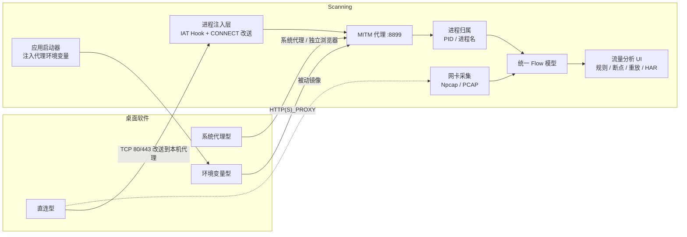

# 桌面软件流量抓包分析方案

| 项目 | 内容 |
| --- | --- |
| 文档状态 | M5a/M5b 已实现，M5c 进程注入模式已实现（Windows，实验） |
| 适用版本 | M5 及以后 |
| 关联文档 | [technical-design.md](technical-design.md) |
| 更新日期 | 2026-10-23 |

> 实现状态（2026-10-23）：M5a 桌面应用启动器、M5b 进程归属（Windows/Linux）与 M5c 进程注入模式（Windows x64）已落地；macOS 进程归属与注入尚未实现。按用户要求，M5c 不使用 WinDivert/WFP 或内核驱动，改为用户态 DLL 注入 + IAT Hook。

## 1. 背景与目标

Scanning 目前已具备：

- MITM 代理（默认 `127.0.0.1:8899`），可解密并改写 HTTP/HTTPS；
- 上游代理链式转发，可接在本地 VPN/公司代理之前；
- 网卡/PCAP 报文采集，可观察 DNS、TCP、TLS SNI 与明文 HTTP；
- 浏览器启动器：用独立配置目录启动仅走本代理的 Edge/Chrome/Chromium。

但桌面软件与浏览器差异很大：有的读取系统代理，有的只认环境变量，有的完全直连，还有的使用证书固定或 QUIC。仅靠“启动浏览器”无法覆盖这些场景。

本方案的目标：

1. **无侵入优先**：尽量不修改系统代理、不安装驱动，先覆盖“愿意走代理”的桌面软件；
2. **可分析**：捕获的请求继续复用现有 Flow、规则、断点、重放、Diff、HAR 与会话能力；
3. **可归因**：尽可能把流量归属到具体进程（进程名、PID、路径），支持按应用分析；
4. **渐进覆盖**：对忽略代理的软件，提供可选的进程注入模式；对无法解密的软件，明确降级为报文级观测；
5. **安全可控**：启动任意可执行文件、注入进程都必须由用户显式操作，并给出清晰的风险提示与恢复路径。

非目标：

- 破解证书固定（Pinning）、绕过反作弊或应用自身的 TLS 校验；
- 替代完整 VPN/防火墙产品；
- 在 v1 阶段覆盖 Android/iOS 或远程设备；
- 默认对任意进程注入 Hook 或默认以管理员权限运行。

## 2. 桌面软件流量路径分析

| 类型 | 典型应用 | 是否读系统代理 | 是否读 `HTTP(S)_PROXY` | 现有代理能否捕获 |
| --- | --- | --- | --- | --- |
| 系统代理型 | Edge/Chrome、部分 Electron、.NET/WinINET 应用 | 是 | 通常否 | 改系统代理或独立浏览器可捕获 |
| 环境变量型 | curl、Go、Python requests、多数 libcurl 客户端 | 否 | 是 | 需以代理环境变量启动 |
| 自有代理设置 | 部分 IM、下载器、开发工具 | 否 | 否 | 需在应用内手动设置代理 |
| 直连型 | 自带网络栈、硬编码地址、Node.js 默认实现 | 否 | 否 | 代理模式无法捕获 |
| 加固型 | 证书固定、自定义信任库、QUIC/HTTP3 | 可能 | 可能 | 可能只能看到报文或完全绕过 |

由此得出结论：**没有单一模式能覆盖所有桌面软件**，需要分层接入：

1. 系统代理（已有能力，文档引导）；
2. 环境变量启动器（低成本、可归因）；
3. 进程注入（覆盖直连型，需与目标进程同权限）；
4. 网卡被动抓包（兜底观测，无法解密 HTTPS 正文）。

## 3. 方案对比

| 方案 | 覆盖范围 | HTTPS 解密 | 权限要求 | 侵入性 | 跨平台 | 复杂度 | 建议阶段 |
| --- | --- | --- | --- | --- | --- | --- | --- |
| 系统代理 | 读系统代理的应用 | 是 | 用户级 | 中（改系统设置） | 是 | 低 | 已有 |
| 独立浏览器启动器 | Chromium 系浏览器 | 是 | 用户级 | 低（独立配置目录） | 是 | 低 | 已完成 |
| 桌面应用启动器（环境变量） | 读环境变量的应用 | 是 | 用户级 | 低（仅子进程） | 是 | 低 | **M5a** |
| 透明重定向（WinDivert/WFP） | 直连型 TCP 应用 | 是（SNI 可识别时） | 管理员 + 驱动 | 高 | 分平台实现 | 高 | **不采用（本次明确排除）** |
| TUN 虚拟网卡 | 全 IP 流量 | 是 | 管理员 + 驱动 | 高 | 高 | 很高 | 暂不实施 |
| 网卡被动抓包 | 本机全部流量 | 否（仅元数据） | Npcap + 管理员 | 低 | Windows 优先 | 中 | 已有 |
| API Hook / DLL 注入 | 单个进程 | 由本机 MITM 代理解密 | 与目标进程同权限 | 高（需显式授权） | 否（当前仅 Windows） | 高 | **M5c（已实现，实验）** |

## 4. 总体架构



设计原则：

- 所有接入方式最终汇聚到同一个代理引擎和 Flow 模型，分析能力不重复实现；
- 注入层只负责“把流量送到代理”，不改写现有规则、断点、存储逻辑；
- 进程归属作为旁路能力，解析失败不影响抓包；
- 任何全局性改动都可一键恢复，并在异常退出后提示恢复。

## 5. 阶段一：桌面应用启动器（M5a）

### 5.1 目标

覆盖读取 `HTTP_PROXY`/`HTTPS_PROXY` 的桌面软件（以及 CLI），无需管理员权限、不改系统设置。

### 5.2 启动方式

用户在界面选择可执行文件，Scanning 以子进程方式启动，并注入：

```text
HTTP_PROXY=http://127.0.0.1:8899
HTTPS_PROXY=http://127.0.0.1:8899
http_proxy=http://127.0.0.1:8899
https_proxy=http://127.0.0.1:8899
NO_PROXY=127.0.0.1,localhost,::1
no_proxy=127.0.0.1,localhost,::1
```

说明：

- 同时设置大小写变量，兼容 curl、Go、Python 等不同实现；
- 不设置 `ALL_PROXY`，避免把不支持 SOCKS 的流量导向错误协议；
- 上游代理仍由 Scanning 内部负责，子进程只感知本机 8899；
- 可选高级环境变量（如 Java 的 `JAVA_TOOL_OPTIONS`）由用户手动添加；
- 对 Chromium 系应用可额外传入 `--proxy-server=http://127.0.0.1:8899`，但必须由用户显式勾选，避免非 Chromium 应用因未知参数退出。

### 5.3 应用选择与文件对话框

Web UI 无法直接打开本地文件选择器。方案：

1. 后端新增“选择可执行文件”接口，由服务端调用本机原生对话框：
   - Windows：PowerShell + `System.Windows.Forms.OpenFileDialog`；
   - macOS：`osascript` 调用 `choose file`；
   - Linux：`zenity --file-selection`，不可用时回退 `kdialog`；
2. 对话框不可用（无桌面、远程 SSH、容器）时，界面提供手动路径输入；
3. 仅接受绝对路径；启动前校验文件存在、是否为普通文件；
4. 记录最近使用的应用（路径、参数、工作目录、最后启动时间），持久化到数据目录。

### 5.4 进程管理

- 使用 `exec.Command` 直接启动，不经过 Shell，避免命令注入；
- 启动后立即返回，记录 PID、启动时间、退出码（异步回收）；
- 标准输出/错误可选写入 `logs/apps/<timestamp>.log`，便于排查；
- 默认不提供“强制结束进程”，避免误杀；后续可加入显式确认的停止操作；
- 子进程产生的孙进程仍会继承环境变量，因此多数情况下无需逐个启动。

### 5.5 捕获诊断

启动后自动检测（已实现）：

- 启动约 6 秒后检查同名进程的 TCP 连接与捕获到的 Flow；若 6 秒时无结果，12 秒再复查一次；
- 有 Flow 或存在指向本机代理的连接 → 显示「已走代理」；
- 只有直连连接 → 显示「未走代理」，并列出前 5 个直连目标 `IP:端口`；
- 均无 → 显示「未检测到」，提示应用可能尚未发起请求或使用非 TCP 协议。

若提示未走代理，给出下一步选项：

- 对目标进程使用「进程注入」（Windows x64，实验）；
- 使用网卡抓包查看是否有直连流量；
- 在应用自身设置中手动填写 `127.0.0.1:8899`。

### 5.6 API 草案

| 方法 | 路径 | 说明 |
| --- | --- | --- |
| POST | `/api/v1/apps/launch` | 启动应用并注入代理环境变量 |
| GET | `/api/v1/apps/recent` | 最近启动的应用 |
| GET | `/api/v1/apps/{id}` | 运行状态、PID、退出码、日志路径 |
| POST | `/api/v1/system/pick-file` | 打开本机文件选择对话框 |

请求示例：

```json
{
  "path": "C:\\Program Files\\Example\\example.exe",
  "args": ["--profile", "test"],
  "cwd": "C:\\Users\\me",
  "env": {"EXAMPLE_TOKEN": "..."},
  "chromiumFlags": false
}
```

### 5.7 安全措施

- 仅允许本机回环来源调用启动接口（默认仅回环监听）；
- 启动前二次确认，明确提示“将以当前用户权限运行该程序”；
- 不解析 Shell 语法，不执行用户输入的拼接命令；
- 路径与参数写入审计日志；
- 启动接口需要鉴权与 `X-Scanning-Request` 头；
- 无头模式（`--headless`）拒绝启动。

## 6. 阶段二：进程归属（M5b）

### 6.1 目标

在 Flow 列表和详情中显示流量所属进程，支持按进程过滤，便于区分多个桌面软件。

现有 `ClientInfo` 已预留字段：

```go
type ClientInfo struct {
    IP   string `json:"ip"`
    Port int    `json:"port"`
    App  string `json:"app,omitempty"`
    PID  int    `json:"pid,omitempty"`
}
```

建议扩展：

```go
type ClientInfo struct {
    IP      string `json:"ip"`
    Port    int    `json:"port"`
    App     string `json:"app,omitempty"`     // 进程名
    PID     int    `json:"pid,omitempty"`
    AppPath string `json:"appPath,omitempty"` // 可执行文件路径（尽力而为）
    Origin  string `json:"origin,omitempty"`  // proxy | pcap | replay | demo
}
```

### 6.2 解析方式

| 平台 | 实现 | 权限与限制 |
| --- | --- | --- |
| Windows | `iphlpapi.dll!GetExtendedTcpTable(TCP_TABLE_OWNER_PID_ALL)` 获取连接与 PID，再查进程名/路径 | 纯 Go syscall，无需 cgo；部分系统进程可能拒绝查询 |
| Linux | `/proc/net/tcp{,6}` 的 inode → 遍历 `/proc/*/fd` 匹配 | 需要同用户或 root |
| macOS | `libproc` / `proc_pidinfo` | 需要 cgo 或辅助进程，复杂度较高 |

代理模式下，服务端接受连接后可拿到客户端源端口，再反查 TCP 表；启动器模式下还可以直接用已知 PID 做交叉校验。

解析失败时：

- `app` 显示 `unknown`；
- 不阻塞 Flow 创建与转发；
- UI 不展示空白的进程列。

### 6.3 分析能力

- Flow 列表新增“进程”列，可按进程过滤；
- 详情页展示进程名、PID、可执行文件路径；
- 侧边栏可按进程聚合流量数量、错误数与流量体积；
- 导出 HAR 时写入 `_scanning.process` 扩展字段；
- 规则匹配可扩展 `process` 维度（后续评估）。

## 7. 阶段三：进程注入接入（M5c，Windows，实验）

### 7.1 目标

对不读取系统代理/环境变量、直接连接 80/443 的桌面软件，在不安装 WinDivert、不加载内核驱动的前提下，把 TCP 连接改送到本机 MITM 代理，并继续复用 Flow、规则、断点、重放、会话与 HAR。

### 7.2 组成

| 组件 | 实现 | 职责 |
| --- | --- | --- |
| Go 注入管理器 `internal/hook` | `OpenProcess`、`VirtualAllocEx`、`WriteProcessMemory`、`CreateRemoteThread(LoadLibraryW)` | 写配置、注入 DLL、记录 PID、持久化 `injected.json` |
| Hook DLL `internal/hook/native` | C + Zig/MinGW，x64 | IAT Hook、CONNECT 握手、进程内日志 |
| 代理 | 现有 `127.0.0.1:8899` | 识别 `X-Scanning-Hook`；443 走 MITM，80 走明文 HTTP 解析 |

### 7.3 注入与 Hook 流程

1. API 收到 PID/进程名后校验代理已启动、请求来自回环、目标为 x64；
2. 写入 `%APPDATA%\Scanning\hook\scanning_hook.ini`（UTF-16LE BOM），包含 `proxy` 与 `ports`；
3. 打开目标进程，分配远程内存写入 DLL 路径，`CreateRemoteThread` 调用 `LoadLibraryW`，并通过模块列表校验加载结果；
4. DLL 后台线程解析 `ws2_32!connect`、`WSAConnect`、`WSAIoctl` 地址，扫描所有模块的 IAT，将匹配项替换为 detour；延迟加载/新加载模块每 2 秒重扫；
5. 目标调用 `connect`/`WSAConnect`，或通过 `WSAIoctl` 获取 `ConnectEx`（Chromium/libuv 路径）时，被 detour 接管；
6. detour 过滤回环、未配置端口、代理自身地址与已绑定非回环地址；对本机代理发起连接并发送 `CONNECT ip:port`，等待 200；
7. 代理对 443 Peek ClientHello 读取 SNI，签发叶证书并 MITM；对带 `X-Scanning-Hook: 1` 的 80 端口 CONNECT 升级为明文 HTTP 解析，从 Host 头还原域名；
8. Flow 通过 TCP 表反查 PID，归因到目标进程，继续走规则/断点/重放；
9. 对 `*.music.163.com` 的 `/eapi/`、`/xeapi/` 流量，用 AES-128-ECB 解码响应体（`/eapi/` 请求额外解码 `params`）；正文预览、详情和下载均使用解密后的 JSON，原始密文仍可通过 `raw=1` 下载。

网易云 EAPI 解码：

- 请求明文形如 `/api/v6/playlist/detail-36cd479b6b5-{json}`，展示时提取 JSON 部分；
- 响应体是原始 AES-128-ECB 密文，解密后为 JSON；
- 原始正文仍按字节保存，不改变转发、重放与 HAR 的原始数据；
- 下载按钮默认导出 `.json`；锁形按钮导出原始密文 `.bin`；
- 若客户端升级更换密钥或正文被截断，自动回退为二进制占位并保留 `.bin` 下载。

安全性：

- IAT 替换只改目标进程私有地址空间，不修改系统组件；
- 不使用 inline hook，避免指令长度解码；
- 尝试注册 CFG 合法调用目标；不绕过证书固定、反调试或进程保护；
- 仅回环 API 可调用，需用户显式注入，注入记录持久化到 `injected.json`。

### 7.4 覆盖范围与限制

| 场景 | 结果 |
| --- | --- |
| TCP 80/443 直连 | 捕获；HTTPS 解密，HTTP 记录 |
| `connect` / `WSAConnect` | 捕获 |
| 注入后通过 `WSAIoctl` 获取的 `ConnectEx` | 捕获 |
| 注入前已缓存的 `ConnectEx` 指针 | 可能不捕获；可重启目标后再注入 |
| UDP / QUIC 443 | 不捕获；当前不阻断 |
| 32 位进程 / ARM64 | 当前不支持（仅提供 x64 DLL） |
| 目标权限/完整性级别更高 | 注入失败并返回明确错误 |
| 杀软/反作弊/进程保护 | 可能拦截 `CreateRemoteThread` 或 `LoadLibrary` |
| 证书固定（Pinning） | TLS 握手失败，记录失败原因，不尝试绕过 |
| 无 SNI 的 TLS | 以 IP 签发证书，部分客户端会拒绝 |
| 80/443 上的非 HTTP 协议 | 可能无法解析；不在 `hook.ports` 的端口保持直连 |

### 7.5 实测结果（2026-10-23）

环境：Windows 11，网易云音乐 3.1.40 x64（CEF + libcurl + cronet），Scanning 默认 `127.0.0.1:8899`。

- 注入主进程 `cloudmusic.exe`（PID 27876）成功，进程保持响应；
- Hook 日志显示 `cloudmusic.dll`、`libcurl.dll`、`libcef.dll`、`cronet`、`network_strategy_sdk` 等模块 IAT 已替换；
- 捕获并解密 `interfacepc.music.163.com` POST 200、`clientlog3.music.163.com` POST 200、`dns.google` GET 200；
- Flow 正确归因为 `cloudmusic.exe`（PID 27876）；
- 另用原生 HTTP 测试程序与 Node（`ConnectEx` 路径）验证了 80/443 两条链路。

## 8. 网卡被动抓包定位

网卡模式不修改任何代理设置，适合：

- 快速判断桌面软件是否发起连接、连接了哪些域名/IP；
- 观察 DNS、TLS SNI、明文 HTTP；
- 在进程注入不可用时提供兜底证据。

限制：

- HTTPS 正文不可见，除非同时开启 MITM；
- 需要 Npcap 与管理员权限；
- 只提供报文级视图，无法使用规则改写、重放等 Flow 能力。

## 9. 界面设计

新增“桌面应用”入口，建议放在侧边栏或顶栏代理状态菜单中：

```text
┌─────────────────────────────────────────────┐
│ 桌面应用抓包                                │
│                                             │
│ [选择应用…]  [启动并抓包]                   │
│                                             │
│ 最近应用                                    │
│  example.exe   代理启动   12:30   [再次启动]│
│  tool.exe      进程注入   11:02   [启动]    │
│                                             │
│ 捕获方式                                    │
│  ○ 环境变量启动（无需管理员）               │
│  ● 进程注入（Windows x64，实验）            │
│                                             │
│ 提示：应用未读取代理设置时，可注入其进程    │
└─────────────────────────────────────────────┘
```

流量列表新增：

- 进程列（进程名 + PID 悬浮提示）；
- 来源徽标：`启动器`、`系统代理`、`报文`（进程注入流量复用代理来源，通过进程列区分）；
- 空状态引导：启动应用 / 打开抓包浏览器 / 导入 PCAP。

## 10. 配置草案

```yaml
launcher:
  enabled: true
  chromium_flags: false      # 仅对 Chromium 应用追加 --proxy-server
  extra_env: {}              # 全局附加环境变量
  log_stdout: false

hook:
  dll_path: ""               # 留空时自动查找 bin/hook/scanning_hook_x64.dll
  ports: [80, 443]           # 仅接管这些目标端口的 TCP
```

配置优先级沿用现有规则：命令行 > 环境变量 > 配置文件 > 默认值。进程注入不会自动执行，必须由用户在界面中显式选择进程并注入。

## 11. 数据与 API 变更

- `Flow.Client` 增加 `appPath`、`origin`；
- 新增应用启动记录（内存 + 数据目录 `apps.json`）；
- 新增进程注入接口：
  - `GET /api/v1/hook/status`：DLL 路径、代理地址、端口、已注入进程与日志路径；
  - `GET /api/v1/hook/processes?name=cloudmusic.exe`：按名称扫描进程并标记是否已注入；
  - `POST /api/v1/hook/inject`：按 `pid` 或 `name` + `all` 注入；
  - `GET /api/v1/hook/log`：读取 Hook 日志尾部；
- 注入相关文件：`%APPDATA%\Scanning\hook\scanning_hook.ini`（DLL 配置）、`injected.json`（注入记录）、`scanning_hook.log`（进程内日志）；
- WebSocket 增加 `app.status` 事件，前端实时更新运行状态；
- HAR 导出增加进程、来源等扩展字段。

## 12. 里程碑与验收

### M5a：桌面应用启动器

验收标准：

1. 能选择并启动一个读取 `HTTPS_PROXY` 的示例程序，代理成功捕获其 HTTPS 请求；
2. 不修改系统代理，不影响其他应用；
3. 应用退出后状态正确更新；
4. 未找到代理流量时给出明确诊断提示；
5. Windows/macOS/Linux 至少各有一个可用启动路径；
6. 启动接口仅本机可用，具备鉴权与命令注入防护。

### M5b：进程归属

验收标准：

1. Windows 下能正确显示常见桌面应用的进程名与 PID；
2. 进程解析失败不影响抓包；
3. 支持按进程过滤与聚合；
4. 导出 HAR 包含进程信息。

### M5c：Windows 进程注入（实验）

验收标准：

1. 对不读取代理设置的直连应用，注入后能捕获并解密 TCP 443 上的 HTTPS；
2. 对 `connect`、`WSAConnect` 与注入后获取的 `ConnectEx` 均能接管；
3. 80 端口能记录明文 HTTP Flow，并从 Host 头还原域名；
4. 证书固定、权限不足、杀软拦截时有明确错误，不崩溃；
5. 与目标进程同权限/完整性级别时可注入，通常无需管理员；
6. 代理自身、回环地址及未配置端口不被重定向，无环路；
7. 注入记录持久化，重启 Scanning 后仍能显示已注入进程；
8. 实测网易云音乐主进程，捕获 `interfacepc.music.163.com` 等请求。

### M5d：macOS/Linux 进程注入（可选）

根据 M5c 的实际效果与需求再评估；Linux 可研究 `LD_PRELOAD`/`ptrace`，macOS 受 SIP 与代码签名限制更大。当前不实现。

## 13. 风险与待决问题

| 风险 | 影响 | 缓解 |
| --- | --- | --- |
| 进程注入被滥用 | 高 | 仅回环 API、鉴权、显式操作与审计日志；后续可加白名单 |
| 杀软/反作弊拦截注入 | 中 | 返回明确错误；回退环境变量启动器或网卡抓包 |
| 注入导致目标进程不稳定 | 中 | 仅替换 IAT 数据、不使用 inline hook；先在测试进程验证 |
| 注入后无法安全卸载 | 中 | 文档说明需重启目标进程恢复；不提供强行卸载 |
| 证书固定无法解密 | 中 | 明确提示，不承诺覆盖 |
| QUIC/UDP 导致漏抓 | 中 | 报文观测；后续评估按进程阻断 UDP 443 |
| 32 位/ARM64 进程不支持 | 低 | 当前明确提示；后续按需构建 x86 DLL |
| 多进程/子进程归因不准 | 低 | 以 TCP 表为准；支持按名称批量注入 |

待决问题：

1. 是否为 32 位/ARM64 进程提供对应 DLL？（当前仅 x64，后续按需）
2. 是否默认注入同名子进程？（当前由用户勾选「注入全部同名进程」）
3. 是否支持按进程阻断 UDP/QUIC？（建议后续评估）
4. 进程归属是否纳入规则匹配维度？（建议先展示，后续评估）
5. 是否支持远程设备？（不在本方案范围）

## 14. 推荐实施顺序

1. **M5a 应用启动器**：复用现有浏览器启动器代码，收益最大、风险最低；
2. **M5b 进程归属**：让“哪个软件在发请求”可见，是桌面分析的核心体验；
3. **M5c Windows 进程注入**：已实现并通过网易云实测；后续补充 32 位、UDP 阻断与更多应用验证；
4. **M5d 其他平台**：按需求推进。

进程注入已落地，桌面软件抓包能力由“应用启动器 + 系统代理 + 进程注入 + 网卡/PCAP 观测”组合覆盖，并在界面上明确每种方式的覆盖范围与限制。
