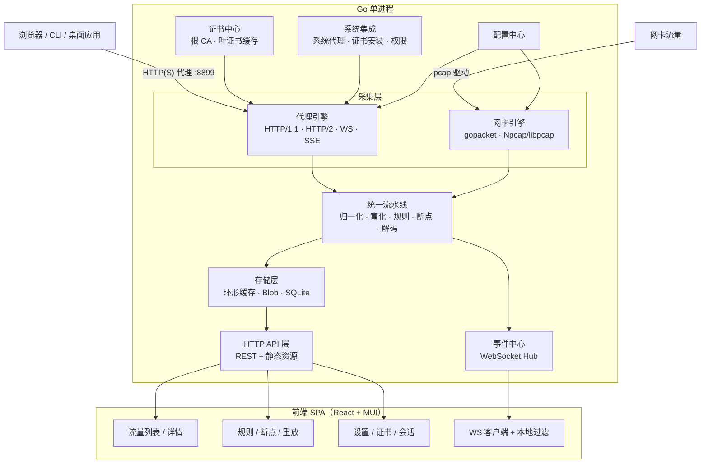
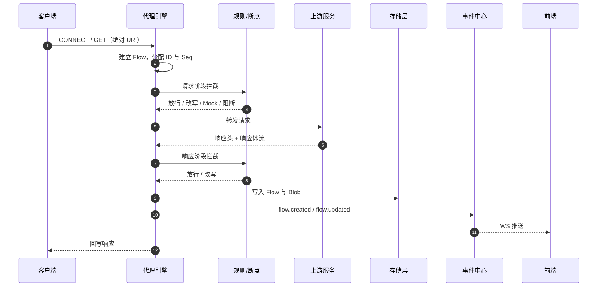
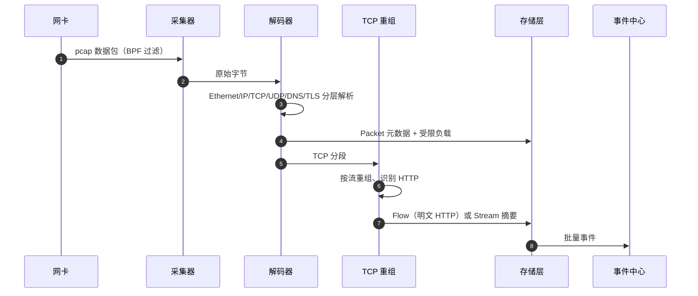
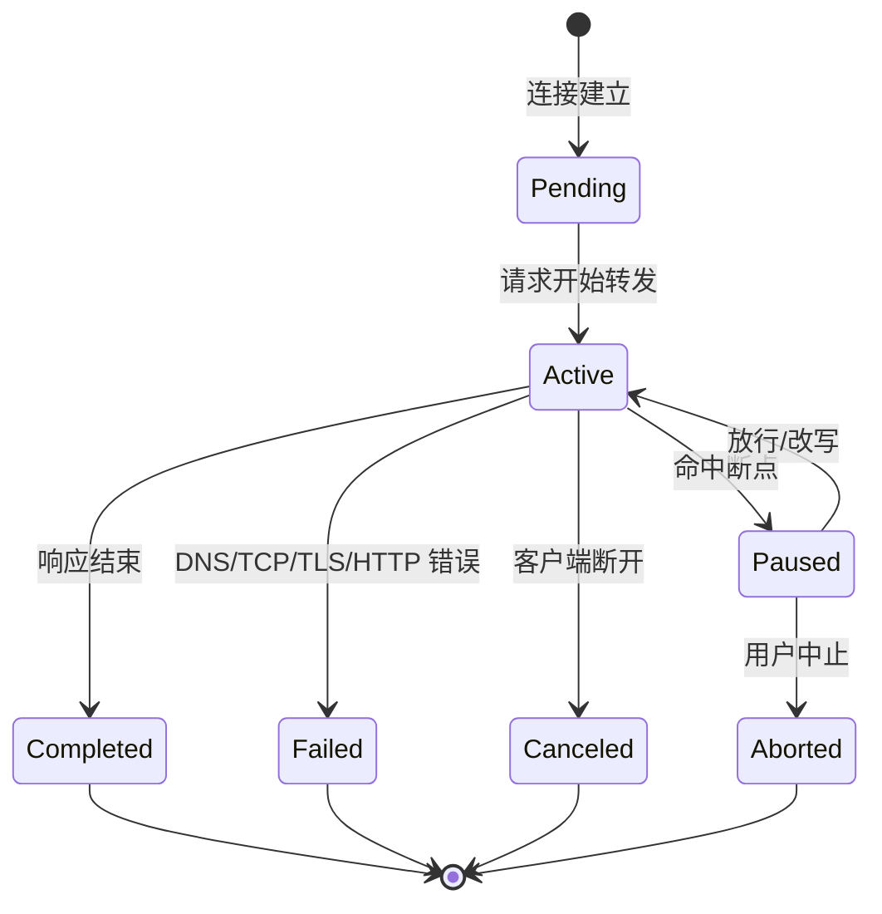
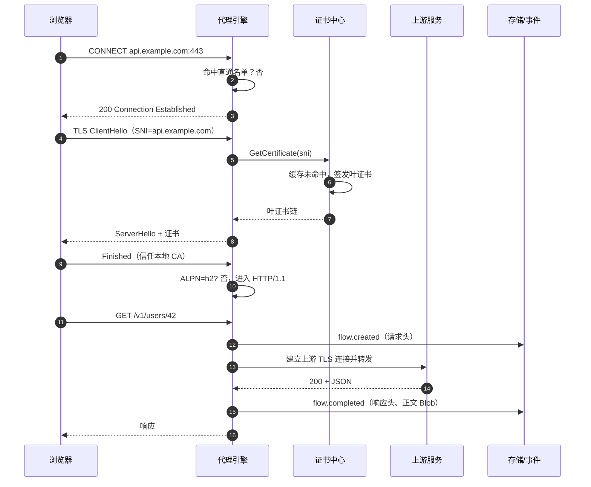
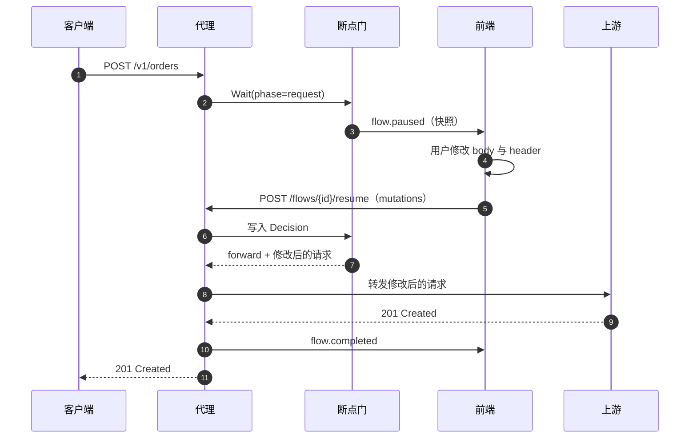
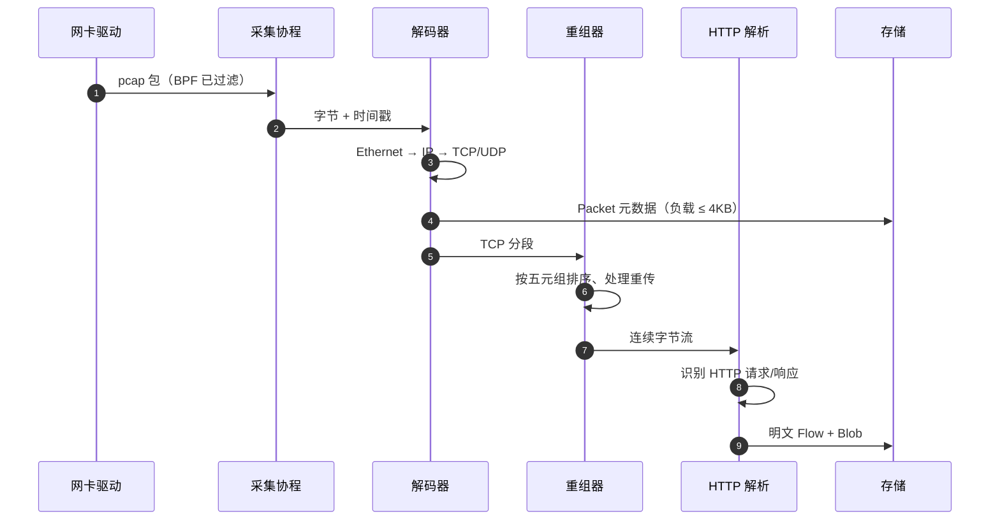
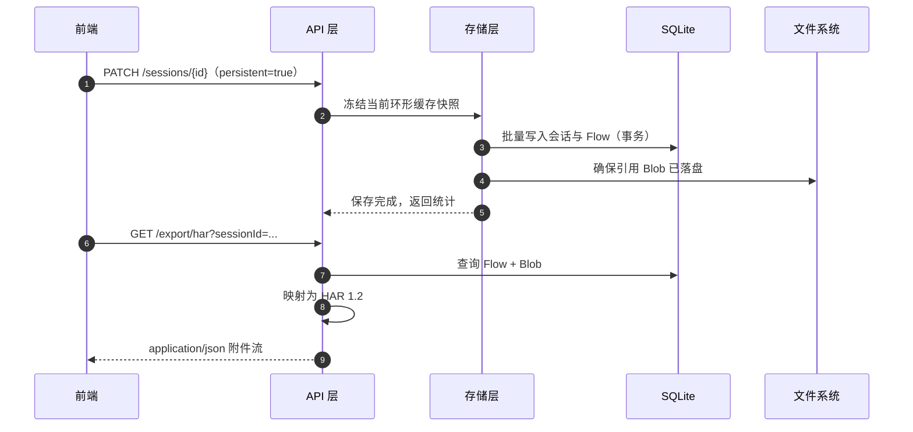
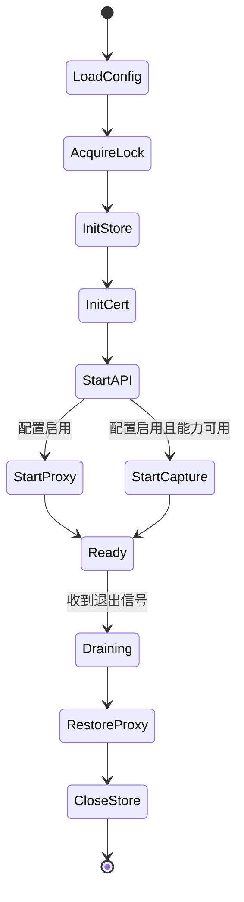

# Scanning 抓包工具技术设计文档

| 项目 | 内容 |
| --- | --- |
| 文档版本 | v0.1（草案） |
| 更新日期 | 2026-10-23 |
| 适用版本 | 0.x |
| 技术栈 | Go + React + TypeScript |
| 文档状态 | 待评审 |

**变更记录**

| 版本 | 日期 | 变更内容 |
| --- | --- | --- |
| v0.1 | 2026-10-23 | 首版，覆盖双引擎抓包、代理 MITM、规则断点、API 与前端设计 |

**目录**

- [0. 文档说明](#0-文档说明)
- [1. 项目概述](#1-项目概述)
- [2. 需求分析](#2-需求分析)
- [3. 技术选型](#3-技术选型)
- [4. 总体架构](#4-总体架构)
- [5. 核心模块设计](#5-核心模块设计)
- [6. 数据模型](#6-数据模型)
- [7. API 设计](#7-api-设计)
- [8. 数据库设计](#8-数据库设计)
- [9. 关键流程时序](#9-关键流程时序)
- [10. 前端设计](#10-前端设计)
- [11. 性能设计](#11-性能设计)
- [12. 安全设计](#12-安全设计)
- [13. 跨平台适配](#13-跨平台适配)
- [14. 工程与交付](#14-工程与交付)
- [15. 附录](#15-附录)

---

## 0. 文档说明

### 0.1 目的

本文档描述 Scanning（工作名）的技术方案，作为后续编码、评审与测试的依据。文档覆盖：

- 产品目标、范围与需求边界；
- 总体架构与技术选型；
- 代理引擎、证书体系、网卡抓包、统一流水线、规则/断点/重放等核心模块；
- 数据模型、HTTP/WebSocket API、持久化设计；
- 前端信息架构与关键交互；
- 性能、安全、跨平台、构建发布、测试与里程碑。

### 0.2 读者

后端工程师、前端工程师、测试工程师、评审人。读者应具备 HTTP/TLS 与 React/Go 的基础知识。

### 0.3 术语

| 术语 | 说明 |
| --- | --- |
| MITM | Man-in-the-Middle，中间人解密。代理持有自签 CA，为每个目标域名动态签发证书，从而解密 HTTPS |
| Flow | 一次逻辑交互。代理模式下为一次请求/响应；网卡模式下为一条重组后的 TCP 流或一次 DNS 查询 |
| Session | 抓包会话。一次录制过程，包含若干 Flow，可保存、导出、删除 |
| Passthrough | 直通。对证书固定或不宜解密的目标只做 TCP 隧道转发，不解密 |
| Breakpoint | 断点。命中规则的请求或响应在转发前暂停，等待用户在 UI 中修改或放行 |
| Replay | 重放。基于已抓取的请求重新发起，可修改参数并对比响应差异 |
| HAR | HTTP Archive 1.2，浏览器与抓包工具通用的导出格式 |
| BPF | Berkeley Packet Filter，网卡抓包的过滤表达式 |
| SNI | TLS Server Name Indication，握手阶段明文携带的目标域名 |
| Blob | 请求/响应体的内容寻址存储单元，按 SHA-256 去重 |

---

## 1. 项目概述

### 1.1 背景

开发者日常排查接口问题时的典型痛点：

1. 浏览器 DevTools 只能观察浏览器自身流量，无法覆盖 CLI、桌面客户端、其他进程；
2. Wireshark 能力完整，但 HTTPS 只能看到密文，且缺少面向 HTTP 的调试工作流；
3. Charles / Fiddler / Proxyman 成熟好用，但为商业软件，跨平台体验不一致，扩展能力有限；
4. 现有工具很少把「应用层解密流量」与「网卡层全量流量」放在同一时间线里对照。

本项目提供一个**本地优先、单进程、双引擎**的抓包与调试工具：代理引擎负责 HTTP/HTTPS/WebSocket/HTTP2 的明文摄取与改包，网卡引擎负责全协议流量概览与 DNS/TCP 观测，二者共享统一的流量模型、过滤语法、存储与前端。

### 1.2 产品目标

| 编号 | 目标 | 验收口径 |
| --- | --- | --- |
| G1 | 双引擎 | 同一进程内可独立或同时运行代理模式与网卡模式；两类记录共享会话、过滤与导出 |
| G2 | 本地优先 | 全量数据仅存本机；无账号体系、无云端上传；默认仅监听回环地址 |
| G3 | 调试闭环 | 抓取 → 过滤 → 查看 → 断点改包 → 重放 → 差异对比，全流程在 UI 内完成 |
| G4 | 跨平台 | Windows 10+、macOS 12+、主流 Linux 发行版可用；单一进程、单一数据目录 |
| G5 | 工程可维护 | 前后端分离、模块边界清晰、核心逻辑有单元/集成测试、可无 CGO 构建代理模式 |

### 1.3 非目标（v1 明确不做）

- 不作为生产网关、旁路镜像或集群级抓包平台；
- 不做多用户、多租户、团队共享与服务端集中存储；
- 不做入侵检测、威胁情报、恶意流量判定；
- 不承诺绕过 TLS Certificate Pinning / mTLS 双向认证；
- 不提供移动端原生 App；手机接入仅通过「设置 Wi-Fi 代理 + 安装 CA」的通用方式支持；
- 不做 HTTP/3（QUIC）解密。QUIC 不经过 HTTP 代理，需在文档中明确该限制并给出规避建议。

### 1.4 目标用户与典型场景

| 编号 | 场景 | 用户动作 | 工具价值 |
| --- | --- | --- | --- |
| S1 | 调试自研 Web/API | 开启代理，浏览器访问页面，定位异常请求 | 明文查看、断点改响应、重放验证 |
| S2 | 调试 CLI / 桌面客户端 | 设置 `HTTP(S)_PROXY` 环境变量或系统代理 | 覆盖浏览器之外的流量 |
| S3 | 复现线上问题 | 导入 HAR / 回放历史请求 | 修改 Header/参数快速验证后端行为 |
| S4 | 排查「请求到底发没发出去」 | 开网卡模式看 DNS/TCP 握手 | 区分 DNS 失败、连接失败、应用层错误 |
| S5 | 接口契约核对 | 导出 HAR 给后端/测试 | 与浏览器 HAR 互通 |
| S6 | 弱网与异常模拟 | 规则里配置延迟、限速、返回 500 | 不依赖后端即可验证前端容错 |

### 1.5 竞品参考与差异化

| 工具 | 优势 | 局限 | 借鉴点 |
| --- | --- | --- | --- |
| Charles | 交互成熟、Map Local/Remote 好用 | 商业授权、Java 技术栈、大流量下卡顿 | 左侧域名树、Structure/Sequence 双视图、断点交互 |
| Fiddler Classic | 规则脚本强、Windows 生态好 | 仅 Windows、界面陈旧 | 自定义规则与 Composer |
| Proxyman | macOS 原生体验、性能好 | 平台受限、付费 | 轻量交互、证书一键安装引导 |
| mitmproxy | 可编程性强、社区活跃 | 无官方 GUI、上手门槛高 | 插件式流水线、脚本化改包 |
| Wireshark | 协议覆盖全、重组与追踪强 | 无 HTTP 调试工作流、HTTPS 不可读 | 网卡抓包、流重组、过滤表达式 |

差异化定位：**本地单二进制 + 双引擎统一时间线 + 面向调试的改包/重放闭环 + 开放数据格式（HAR/PCAP）**。

---

## 2. 需求分析

### 2.1 功能需求

优先级：P0 必须（首个可用版本）、P1 重要（第二个版本）、P2 增强。

#### 2.1.1 代理与抓包

| 编号 | 需求 | 说明 | 优先级 |
| --- | --- | --- | --- |
| FR-01 | HTTP 代理 | 支持绝对 URI 形式的 HTTP/1.1 转发，记录请求与响应 | P0 |
| FR-02 | HTTPS MITM | CONNECT 隧道 + 动态签发证书解密，支持 TLS 1.2/1.3 | P0 |
| FR-03 | CA 管理 | 生成、查看、下载、安装引导、重生成根证书 | P0 |
| FR-04 | 直通名单 | 按域名通配符配置不解密目标，避免客户端因证书固定而断连 | P0 |
| FR-05 | 上游 TLS 校验 | 默认校验上游证书；可显式关闭并在 UI 持续告警 | P0 |
| FR-06 | HTTP/2 | 客户端侧与上游侧均支持 h2；h2 客户端自动协商 | P1 |
| FR-07 | WebSocket | 支持 ws/wss 隧道转发，记录握手与帧元数据 | P1 |
| FR-08 | 流式响应 | SSE / chunked 响应边接收边展示，不等待完整响应 | P1 |
| FR-09 | 网卡抓包 | 选择网卡、BPF 过滤、抓取并存储报文元数据 | P0 |
| FR-10 | 协议解析 | 解析 Ethernet/IP/TCP/UDP/DNS/TLS ClientHello | P0 |
| FR-11 | TCP 重组 | 对 TCP 流重组，识别并解析明文 HTTP | P1 |
| FR-12 | DNS 关联 | 建立域名与 IP 映射，为网卡流量标注主机名 | P1 |
| FR-13 | 进程归属 | 展示流量所属进程（平台相关，尽力而为） | P2 |
| FR-14 | 双引擎关联 | 将代理 Flow 与网卡 TCP 流按五元组关联 | P2 |

#### 2.1.2 查看与检索

| 编号 | 需求 | 说明 | 优先级 |
| --- | --- | --- | --- |
| FR-15 | 流量列表 | 虚拟滚动列表，展示序号/方法/状态/域名/路径/大小/耗时/类型/来源 | P0 |
| FR-16 | 详情面板 | 概览、请求、响应、耗时、原始报文、备注六个维度 | P0 |
| FR-17 | 正文查看 | 文本、JSON 树、十六进制、图片预览、HTML 源码 | P0 |
| FR-18 | 过滤语法 | 统一 DSL，前端即时过滤 + 后端历史查询共用同一语法 | P0 |
| FR-19 | 域名树 | 按 Host 聚合，支持按域名快速筛选 | P1 |
| FR-20 | 搜索正文 | 在 URL/Header/Body 中搜索关键字（含历史会话） | P1 |
| FR-21 | 固定与备注 | 固定重要 Flow、添加标签与备注，清理时保留 | P1 |

#### 2.1.3 规则、断点与重放

| 编号 | 需求 | 说明 | 优先级 |
| --- | --- | --- | --- |
| FR-22 | 规则引擎 | 按请求/响应阶段匹配并执行阻断、Mock、Map Remote、改 Header/Body、延迟、限速 | P1 |
| FR-23 | 断点 | 命中规则的请求或响应暂停，UI 编辑后放行或中止 | P1 |
| FR-24 | 重放 | 编辑并重新发送请求，可覆盖目标地址与认证信息 | P1 |
| FR-25 | 差异对比 | 原响应与重放响应并排/行内 Diff | P1 |
| FR-26 | 脚本规则 | 内嵌 JS 实现复杂改写，带超时与内存限制 | P2 |

#### 2.1.4 导出与系统集成

| 编号 | 需求 | 说明 | 优先级 |
| --- | --- | --- | --- |
| FR-27 | HAR 导出/导入 | HAR 1.2 兼容，供浏览器或第三方工具使用 | P0 |
| FR-28 | PCAP 导出 | 网卡模式导出标准 pcap，代理模式导出合成 pcap（可选） | P1 |
| FR-29 | 系统代理 | 一键设置/恢复系统代理（Windows/macOS/Linux） | P1 |
| FR-30 | 会话管理 | 新建、重命名、保存、删除、清理；支持持久化到 SQLite | P1 |

### 2.2 非功能需求

| 编号 | 维度 | 指标 |
| --- | --- | --- |
| NFR-01 | 性能 | 代理转发引入的额外延迟：本地上游 p50 ≤ 3ms、p95 ≤ 8ms（不含上游耗时） |
| NFR-02 | 吞吐 | 稳定承载 200 并发连接、5k 请求/分钟；网卡模式 500Mbps 以下不丢包（取决于硬件） |
| NFR-03 | 内存 | 基线内存 ≤ 150MB；默认配置下缓存 5 万条 Flow 时总内存 ≤ 500MB；大响应体自动落盘 |
| NFR-04 | UI 流畅度 | 5 万行列表滚动 60fps；事件推送不导致主线程长任务 > 50ms |
| NFR-05 | 启动 | 冷启动到 UI 可交互 ≤ 1.5s |
| NFR-06 | 稳定性 | 单个请求处理异常不影响代理进程；连续运行 24h 无内存持续增长 |
| NFR-07 | 安全 | 默认只监听 127.0.0.1；CA 私钥不通过 API 暴露；本地 API 需要运行时令牌 |
| NFR-08 | 兼容 | Go 1.24+；Chrome/Edge/Firefox/Safari 最新两个大版本；Windows 10+、macOS 12+、Ubuntu 22.04+ |
| NFR-09 | 可观测 | 结构化日志、运行统计（连接数、QPS、丢弃数、内存占用）、pprof 调试端点（仅本机） |
| NFR-10 | 可维护 | 后端核心包测试覆盖率 ≥ 70%；规则与过滤 DSL 有表驱动测试；API 有契约测试 |

### 2.3 约束与假设

1. **解密的前提是客户端信任自签 CA**。未安装或客户端使用证书固定时，只能看到密文或连接失败，工具需给出明确提示。
2. **QUIC/HTTP3 不经过 HTTP 代理**。浏览器访问支持 h3 的站点时可能绕过代理；需要在文档与 UI 中提示，可通过浏览器策略禁用 QUIC 或使用网卡模式观测。
3. **网卡抓包需要提升权限**：Windows 依赖 Npcap 且通常需管理员；macOS 需 root 或 BPF 设备权限；Linux 需 `CAP_NET_RAW`。
4. **不修改用户全局网络配置除非显式操作**。系统代理开关必须可一键恢复，并记录原始值。
5. **v1 只支持单实例运行**。通过数据目录锁文件避免多实例同时监听端口与写库。
6. **Npcap 不可随安装包分发**（其许可证限制再分发），只能检测并引导用户自行安装。

---

## 3. 技术选型

### 3.1 选型原则

- **本地单进程优先**：降低部署与权限复杂度，避免引入数据库服务、消息队列。
- **标准库优先**：能用 `net/http`、`crypto/tls`、`embed` 解决的，不引入框架。
- **性能路径无反射、少分配**：抓包与转发热路径避免 JSON 序列化与锁竞争。
- **前端可独立开发**：Vite 开发服务器 + API 代理，生产构建产物嵌入二进制。
- **可裁剪**：网卡抓包依赖 CGO 与 Npcap，通过 build tag 提供「纯代理」构建。

### 3.2 后端选型

| 领域 | 选择 | 版本基线 | 理由 |
| --- | --- | --- | --- |
| 语言 | Go | 1.24+ | 协程模型适合高并发 IO；静态单二进制；TLS/HTTP 标准库成熟 |
| HTTP 服务 | `net/http` + Go 1.22 路由模式 | 标准库 | 无需第三方路由即可表达 `GET /api/v1/flows/{id}` |
| HTTP/2 | `golang.org/x/net/http2` | 最新稳定 | 客户端侧 h2 需要 `ServeConn`，标准库未直接暴露 |
| WebSocket | `github.com/coder/websocket` | 最新稳定 | API 简洁、基于 context、无额外依赖 |
| 抓包 | `gopacket`（优先社区维护分支 `github.com/gopacket/gopacket`） | v1.2.x | 协议解码、TCP 重组、pcap 读写齐全；锁定分支避免上游停滞 |
| 持久化 | `modernc.org/sqlite`（纯 Go） | 最新稳定 | 免 CGO，避免与 Npcap 的 CGO 构建冲突；支持 WAL |
| 配置 | `gopkg.in/yaml.v3` | v3 | 简单、可读；无需热更新框架 |
| ID | `github.com/oklog/ulid/v2` | v2 | 时间有序，便于游标分页与排序 |
| 压缩解码 | `github.com/klauspost/compress`（zstd/gzip）、`github.com/andybalholm/brotli` | 最新稳定 | 展示层解码 `Content-Encoding` |
| 字符集 | `golang.org/x/net/html/charset` | 最新稳定 | 非 UTF-8 响应转码展示 |
| 脚本（P2） | `github.com/dop251/goja` | 最新稳定 | 纯 Go JS 运行时，可限制时间与内存 |
| 系统集成 | `golang.org/x/sys` | 最新稳定 | Windows 注册表/系统调用、Unix 权限 |

**代理内核：自研，而非直接使用 `elazarl/goproxy`。**

| 方案 | 优点 | 缺点 | 结论 |
| --- | --- | --- | --- |
| `elazarl/goproxy` | 开箱即用，CONNECT/MITM 已封装 | 抽象层较厚，h2、WebSocket、流式采集、断点插入点受限；版本迭代慢 | 仅作参考实现 |
| 自研 `internal/proxy` | 完全控制拦截点、背压、超时、连接复用；可精确度量耗时 | 需自行处理 HTTP/1.1 细节与 h2 分流 | **采用** |
| 反向代理改造 | `httputil.ReverseProxy` 现成 | 面向服务端入口，非正向代理，CONNECT 需另写 | 不复用 |

### 3.3 前端选型

| 领域 | 选择 | 理由 |
| --- | --- | --- |
| 框架 | React 19 + TypeScript 5 | 生态成熟，团队熟悉 |
| 构建 | Vite | 启动快、HMR 好、产物可直接 embed |
| 组件库 | MUI（Material UI） | 组件完整、主题能力强，符合团队偏好 |
| 服务端状态 | TanStack Query | 缓存、失效、重试、分页开箱即用 |
| 客户端状态 | Zustand | 轻量、选择器订阅，适合高频流量更新 |
| 虚拟列表 | TanStack Virtual | 5 万行滚动性能好，比 DataGrid 更可控 |
| 路由 | React Router | 常规方案 |
| 编辑器 | CodeMirror 6 | 体积远小于 Monaco，JSON/XML/文本高亮足够；按需懒加载 |
| 时间处理 | dayjs | 体积小 |
| 测试 | Vitest + Testing Library + Playwright | 单元与端到端覆盖 |

### 3.4 关键取舍

| 决策点 | 方案 A | 方案 B | 选择与理由 |
| --- | --- | --- | --- |
| 前后端部署 | 单二进制 embed 前端 | 前后端独立部署 | **两者都支持**：开发用 Vite，生产默认 embed；`--headless` 时仅提供 API |
| 流量存储 | 全量落库 | 内存环形 + 按需落库 | **热冷分层**：默认内存环形，保存会话时才写 SQLite，避免持续磁盘 IO |
| 实时通道 | SSE | WebSocket | **WebSocket**：需要客户端→服务端的订阅、断点放行等双向消息 |
| 列表数据 | MUI DataGrid | 自研表格 + 虚拟滚动 | **自研 + TanStack Virtual**：列可定制、行高固定、性能可控 |
| 代理内核 | 第三方库 | 自研 | **自研**，理由见 3.2 |
| 数据库 | BoltDB | SQLite | **SQLite**：支持按域名/状态/时间组合查询与聚合，导出方便 |
| 证书密钥 | 明文文件 | 系统钥匙串 | **默认文件 0600，可选钥匙串**：降低首次使用门槛，兼顾安全 |
| 桌面形态 | 浏览器访问本地控制台 | Electron / Tauri 桌面壳 | **v1 浏览器优先**：零额外运行时与安装体积；后续可用 Tauri 包装同一套 UI 与 API |

---

## 4. 总体架构

### 4.1 逻辑架构



端口约定：

| 端口 | 用途 | 默认绑定 |
| --- | --- | --- |
| 8898 | 控制台 UI + REST API + WebSocket | 127.0.0.1 |
| 8899 | HTTP 代理（含 CONNECT） | 127.0.0.1 |

两者分离，便于只把代理端口暴露给虚拟机/局域网（需显式配置并告警），控制面始终留在回环。

### 4.2 分层职责

| 层 | 包 | 职责 | 不做什么 |
| --- | --- | --- | --- |
| 入口层 | `internal/api` | 路由、鉴权、参数校验、错误映射、静态资源 | 不包含业务规则 |
| 采集层 | `internal/proxy`、`internal/capture` | 建立连接、解密、转发、抓包、协议解码 | 不做展示格式转换 |
| 流水线 | `internal/pipeline` | 归一化、富化、规则、断点、解码、脱敏 | 不直接写数据库 |
| 领域层 | `internal/flow`、`internal/rules` | 数据模型、过滤 DSL、规则匹配与动作 | 不感知 HTTP 细节 |
| 存储层 | `internal/store` | 环形缓存、内容寻址 Blob、SQLite 读写、导出 | 不做业务判断 |
| 基础设施 | `internal/platform`、`internal/config` | 系统代理、证书安装、权限检测、配置加载 | 不含抓包逻辑 |

依赖方向：`api → pipeline/store → flow/rules`；`proxy/capture → pipeline`。禁止反向依赖，代理层不得引用 `api` 包。

### 4.3 部署形态

| 形态 | 启动方式 | 前端来源 | 适用 |
| --- | --- | --- | --- |
| 开发模式 | `go run -tags dev ./cmd/scanning --dev` | Vite `http://127.0.0.1:5173`，API 反向代理到 8898 | 日常开发 |
| 生产单机 | `scanning`（双击或命令行） | `embed.FS` 内嵌 `web/dist` | 最终用户 |
| 无头模式 | `scanning --headless --api-token=...` | 不提供 UI，仅 REST/WS | 自动化测试、CI |
| 容器（可选） | 镜像内运行，映射 8898/8899 | 内置 | Linux 服务器调试，需 `--allow-remote` |

单实例约束：启动时对 `<data-dir>/scanning.lock` 加文件锁，失败则提示已有实例并退出。

### 4.4 数据流

**代理模式：**



**网卡模式：**



### 4.5 并发模型

| 组件 | 并发策略 | 上限/背压 |
| --- | --- | --- |
| 代理连接 | h1 由 `net/http` 每连接协程处理；h2 由 `http2.ServeConn`；隧道为双向复制协程 | 最大并发连接 512（可配），超出直接 503 |
| 上游请求 | `http.Transport` 连接池；每 Host 最大空闲 16 | 单请求超时 + 全局 context |
| 网卡采集 | 单采集协程解码；重组与存储分发到有界工作池 | 解码队列 8192，满则丢弃并计数 |
| 存储写入 | 单写协程批量提交 SQLite（每 200ms 或 128 条） | 队列 10000，满则降级为仅内存 |
| 事件推送 | 每 WS 连接一个有界发送队列（1024） | 满时先合并 `flow.updated`，再丢弃并发送 gap 标记 |
| 规则脚本 | 独立 worker + 超时 | 单次 200ms，并发 8 |

所有长生命周期协程接收 `context.Context`，进程退出时按「停止接收新连接 → 等待在途请求 5s → 关闭存储」的顺序优雅退出。

---

## 5. 核心模块设计

### 5.1 代理引擎

包路径：`internal/proxy`。对外接口：

```go
type Engine interface {
    Start(ctx context.Context, cfg Config) error
    Stop(ctx context.Context) error
    Status() Status
}
```

#### 5.1.1 监听与请求接管

代理监听 `127.0.0.1:8899`，使用 `http.Server` 接收两类请求：

1. **明文 HTTP**：请求行是绝对 URI（`GET http://example.com/a HTTP/1.1`）。Go 解析后 `r.URL.IsAbs() == true`，`r.Host` 为上游主机。
2. **HTTPS**：`CONNECT example.com:443 HTTP/1.1`。需要 `Hijack` 接管连接。

CONNECT 处理的关键是：`Hijack` 返回的 `bufio.ReadWriter` 可能已经缓冲了客户端数据（客户端在收到 200 之前就发送 TLS ClientHello 是常见行为）。必须用包装连接先消费缓冲区，否则 TLS 握手会读到空数据。

```go
// bufferedConn 先读 bufio 缓冲区，再读原始连接，避免丢失已预读的字节。
type bufferedConn struct {
    net.Conn
    r *bufio.Reader
}

func (c *bufferedConn) Read(p []byte) (int, error) { return c.r.Read(p) }

func (e *engine) handleConnect(w http.ResponseWriter, r *http.Request) {
    target := r.Host // 形如 example.com:443
    if e.passthrough.Match(target) {
        e.tunnel(w, r, target) // 不解密，直接双向复制
        return
    }

    hj, ok := w.(http.Hijacker)
    if !ok {
        http.Error(w, "hijack unsupported", http.StatusInternalServerError)
        return
    }
    raw, rw, err := hj.Hijack()
    if err != nil {
        return
    }
    // 不在这里 defer raw.Close()：连接所有权会移交给 serveTLS，
    // 由 TLS 处理器或 http.Server 负责最终关闭。

    if _, err = rw.WriteString("HTTP/1.1 200 Connection Established\r\n\r\n"); err != nil {
        _ = raw.Close()
        return
    }
    if err = rw.Flush(); err != nil {
        _ = raw.Close()
        return
    }

    conn := &bufferedConn{Conn: raw, r: rw.Reader}
    e.serveTLS(conn, target)
}
```

#### 5.1.2 HTTPS 中间人

`serveTLS` 完成三件事：TLS 握手、按 ALPN 分流、把解密后的连接交给 HTTP 处理器。

```go
func (e *engine) serveTLS(conn net.Conn, target string) {
    host, _, _ := net.SplitHostPort(target)

    tlsConn := tls.Server(conn, &tls.Config{
        MinVersion: tls.VersionTLS12,
        NextProtos: []string{"h2", "http/1.1"},
        // SNI 为空（客户端直接访问 IP）时回退到 CONNECT 目标，
        // 不能用 hello.Conn.LocalAddr()：那是代理自己的监听地址。
        GetCertificate: func(hello *tls.ClientHelloInfo) (*tls.Certificate, error) {
            name := hello.ServerName
            if name == "" {
                name = host
            }
            return e.certs.CertificateFor(name)
        },
    })

    ctx, cancel := context.WithTimeout(context.Background(), e.cfg.TLSHandshakeTimeout)
    defer cancel()
    if err := tlsConn.HandshakeContext(ctx); err != nil {
        e.metrics.TLSHandshakeFailed.Add(1)
        _ = tlsConn.Close() // 握手失败：此处仍持有连接，负责关闭
        return
    }

    state := tlsConn.ConnectionState()
    e.metrics.ObserveTLSVersion(state.Version, host)

    if state.NegotiatedProtocol == "h2" {
        // 客户端侧 HTTP/2：交由 x/net/http2 处理单连接
        defer tlsConn.Close()
        e.h2.ServeConn(tlsConn, &http2.ServeConnOpts{
            Handler: e.handlerFor(host),
            Context: context.WithValue(context.Background(), ctxKeyMITMHost, host),
        })
        return
    }

    // 客户端侧 HTTP/1.1：把连接推入单连接监听器，由 http.Server 统一处理。
    // 所有权在此移交，本函数不得再关闭 tlsConn。
    e.mitmListener.Push(tlsConn)
}
```

说明：

- `mitmListener` 实现 `net.Listener`，内部是一个带缓冲的 `chan net.Conn`，`Accept` 从通道取连接；启动时在独立 goroutine 中执行 `http.Server.Serve(mitmListener)`。通道满时拒绝新连接并计数，避免阻塞 `handleConnect`。这样 HTTP/1.1 的 keep-alive、chunked、`Expect: 100-continue` 全部由标准库处理，避免手写解析。
- 客户端侧 h2 与 h1 使用同一个 `http.Handler`，处理器通过 `r.TLS.ServerName` 或 context 获取目标主机。
- h2 请求没有绝对 URI 形式，`r.URL.Scheme` 可能为空：需要用 `r.TLS != nil` 推断 `https`，用 `r.Host` 作为 authority 重建上游 URL。
- 证书中的 SAN 必须覆盖实际访问的主机名；SNI 为空（直接用 IP 访问）时回退到 CONNECT 的 host。
- CONNECT 并不保证目标是 TLS：握手前先 `Peek(3)`，若不是 TLS 记录头（`0x16 0x03`），按明文隧道直通，避免误判为证书问题。

#### 5.1.3 上游转发

上游使用共享 `http.Transport`，并针对调试场景做如下配置：

```go
transport := &http.Transport{
    Proxy:                 e.upstreamProxy, // 支持再上一级代理（企业网络）
    ForceAttemptHTTP2:     true,
    MaxIdleConns:          256,
    MaxIdleConnsPerHost:   16,
    IdleConnTimeout:       90 * time.Second,
    TLSHandshakeTimeout:   10 * time.Second,
    ExpectContinueTimeout: 1 * time.Second,
    ResponseHeaderTimeout: e.cfg.ResponseHeaderTimeout, // 默认 30s
    DialContext: (&net.Dialer{
        Timeout:   10 * time.Second,
        KeepAlive: 30 * time.Second,
    }).DialContext,
    TLSClientConfig: &tls.Config{
        MinVersion:         tls.VersionTLS12,
        InsecureSkipVerify: e.cfg.UpstreamInsecureSkipVerify, // 默认 false
    },
}
```

限制与保护：

- 逐跳 Header（`Connection`、`Proxy-Connection`、`Keep-Alive`、`TE`、`Trailer`、`Upgrade` 中除 WebSocket 外的值）在转发前剥离。
- `Host` 保留客户端原始值，允许通过规则改写。
- 请求体默认流式转发，不整体读入内存；仅当规则需要检查正文或命中断点时，才在阈值内缓冲。
- 上游返回 1xx（含 100-continue、103 Early Hints）时原样回传并记录。
- 关闭上游校验时，UI 顶部常驻红色告警条，并在流详情标注 `tls.verified=false`。

#### 5.1.4 请求/响应采集

采集使用 Tee 方式：数据照常流向对端，同时写入受限缓冲区。

```go
type captureWriter struct {
    limit    int64 // 默认 10MB
    buf      bytes.Buffer
    spill    *os.File // 超过阈值后写入临时文件
    n        int64
    hash     hash.Hash
    truncated bool
}
```

策略：

| 参数 | 默认值 | 说明 |
| --- | --- | --- |
| `max_body_bytes` | 10MB | 单条消息最多保留的正文；超出部分丢弃并标记 `truncated` |
| `spill_threshold` | 256KB | 超过后写临时文件，内存只保留摘要与哈希 |
| `capture_binary` | true | 二进制正文只保留前 64KB 用于十六进制预览 |
| `decode_content` | true | 展示时按 `Content-Encoding` 解码，存储仍保留原始字节 |

正文存储为内容寻址 Blob：`sha256` 作为键，相同内容只存一份（重复的静态资源与相同响应可显著降内存）。

#### 5.1.5 流式响应与 SSE

对 `Content-Type: text/event-stream` 或 `Transfer-Encoding: chunked` 且未知长度的响应：

- 不等待响应结束，先推送 `flow.created` 与响应头；
- 每积累 32KB 或每 200ms 推送一次 `flow.body.chunk`（base64）；
- 连接结束时推送 `flow.completed`，包含总大小与耗时；
- 详情页以「追加模式」渲染，可随时停止跟随。

#### 5.1.6 WebSocket

识别 `Connection: Upgrade` + `Upgrade: websocket`：

1. 先与上游完成 WebSocket 握手，再把上游的状态行与 Header 回写客户端的 101 响应（不能先给客户端 101，否则无法向上游拒绝传递）；
2. 双向复制帧，解析帧头（opcode、mask、长度），正文只保留前 64KB；
3. 记录帧列表：方向、opcode、长度、时间戳、预览；
4. `ping/pong/close` 原样转发，不修改；
5. 页面详情以「消息流」展示，可过滤只看向上/向下。

h2 上的 WebSocket（RFC 8441）v1 不支持，回退为普通请求。

#### 5.1.7 直通与失败处理

| 场景 | 行为 |
| --- | --- |
| 命中直通名单 | CONNECT 后仅做 TCP 双向复制，记录字节数与起止时间，不解密 |
| 远程模式未认证 | 返回 407 与 `Proxy-Authenticate`，拒绝建立隧道（仅非回环监听时启用） |
| 客户端不信任 CA | TLS 握手失败，创建失败 Flow（记录目标主机与阶段），UI 提示「安装证书」 |
| 上游连接失败 | 返回 502，Flow 状态 `failed`，记录错误码与阶段（DNS/TCP/TLS/HTTP） |
| 上游超时 | 返回 504，保留已接收的部分响应（若有） |
| 客户端提前断开 | `context.Canceled`，Flow 标记 `canceled`，不视为错误 |
| 请求体过大且规则需读取 | 按 `max_body_bytes` 截断匹配，UI 标注「规则基于截断内容」 |

### 5.2 证书体系

包路径：`internal/mitm`。

#### 5.2.1 根证书

| 属性 | 取值 |
| --- | --- |
| 主题 | `CN=Scanning Root CA, O=Scanning, C=CN`（可在设置中修改） |
| 密钥 | RSA 2048（默认，兼容性最好）；可选 ECDSA P-256 |
| 有效期 | 10 年 |
| 扩展 | `BasicConstraints CA=true`、`KeyUsage CertSign / CRLSign` |
| 序列号 | 128 位随机数 |
| 存储 | `<data-dir>/certs/ca.pem`、`ca.key`（0600，目录 0700） |

#### 5.2.2 叶证书

按 SNI 动态签发并缓存：

- `CN` 与 `SAN` 均包含目标主机；目标是 IP 时写入 `IPAddresses`；
- `KeyUsage: DigitalSignature / KeyEncipherment`，`ExtKeyUsage: ServerAuth`；
- `NotBefore = now-1h`，`NotAfter = now+397d`（规避主流浏览器对证书有效期的限制）；
- 缓存键为 `host`，LRU 容量 4096；证书到期前 24h 自动重签；
- 首次签发耗时约 3–10ms，命中缓存后可忽略；未命中时并发签发需加 singleflight 防止重复计算。

```go
// CertificateFor 供代理在 TLS 配置中调用；host 由调用方保证非空。
func (c *CertCenter) CertificateFor(host string) (*tls.Certificate, error) {
    host = strings.ToLower(strings.TrimSuffix(host, "."))
    if cert, ok := c.cache.Get(host); ok {
        return cert, nil
    }
    v, err, _ := c.sf.Do(host, func() (any, error) {
        return c.issue(host)
    })
    if err != nil {
        return nil, err
    }
    cert := v.(*tls.Certificate)
    c.cache.Add(host, cert)
    return cert, nil
}
```

#### 5.2.3 证书安装与轮换

| 平台 | 安装方式 | 说明 |
| --- | --- | --- |
| Windows | `certutil -addstore -user Root ca.pem` | 用户级安装无需管理员；企业策略可能禁用 |
| macOS | 用户级：`security add-trusted-cert -r trustRoot -k ~/Library/Keychains/login.keychain-db ca.pem`；系统级：`sudo security add-trusted-cert -d -r trustRoot -k /Library/Keychains/System.keychain ca.pem` | 需要用户确认钥匙串访问 |
| Linux | `sudo cp ca.pem /usr/local/share/ca-certificates/scanning.crt && sudo update-ca-certificates` | 系统级；Chrome 使用 NSS 库，需额外 `certutil -d sql:$HOME/.pki/nssdb -A ...` |
| Firefox | 独立证书库 | 引导用户在设置中导入，或使用 `certutil` 指定 profile |

规则：

- 私钥**永不出现在任何 API 响应**中；API 只允许下载 `ca.pem`。
- 「重新生成 CA」需要二次确认，并提示旧证书立即失效、需重新安装。
- 可选启用「私钥加密」：使用 AES-GCM 加密 `ca.key`，密钥保存在系统钥匙串（Windows Credential Manager / macOS Keychain / Secret Service）。

### 5.3 网卡抓包引擎

包路径：`internal/capture`。通过 build tag 隔离 CGO 依赖：

- `//go:build pcap && cgo`：真实抓包实现，依赖 `gopacket/pcap` 与 Npcap/libpcap；
- `//go:build !pcap`：桩实现，启动时返回 `ErrCaptureUnavailable`，附带安装指引。

这样默认构建（纯代理）无需安装 Npcap SDK，也能在 CI 与受限环境中编译运行。

#### 5.3.1 采集

```go
handle, err := pcap.OpenLive(iface, 65535, false, 100*time.Millisecond)
if err != nil {
    return fmt.Errorf("open %s: %w", iface, err)
}
defer handle.Close()

if err := handle.SetBPFFilter(cfg.BPF); err != nil { // 默认 "tcp or udp or icmp or icmp6"
    return fmt.Errorf("bpf: %w", err)
}

// 若驱动支持立即模式，可在打开时启用，降低小包延迟；需按 gopacket 版本确认可用 API。

src := gopacket.NewPacketSource(handle, handle.LinkType())
src.NoCopy = true   // 热路径零拷贝
src.Lazy = true
for {
    select {
    case <-ctx.Done():
        return nil
    case pkt, ok := <-src.Packets():
        if !ok {
            return nil
        }
        decoder.Decode(pkt) // 只取所需字段，负载在必要时才复制
    }
}
```

采集参数：

| 参数 | 默认值 | 说明 |
| --- | --- | --- |
| `snaplen` | 65535 | 抓取完整报文 |
| `promisc` | false | 默认不开启混杂模式，降低隐私影响 |
| `timeout` | 100ms | 用于及时响应取消 |
| 解码队列 | 8192 | 满则丢弃并累计 `dropped_decode` |
| 负载保留 | 每包 4KB | 超出只存元数据与哈希 |
| 统计 | 每 2s | 采集数、丢弃数、驱动丢弃数（`pcap.Stats`） |

#### 5.3.2 协议解码

使用 `gopacket.DecodingLayerParser` 逐层解码，避免反射与接口分配：

```go
var (
    eth  layers.Ethernet
    ip4  layers.IPv4
    ip6  layers.IPv6
    tcp  layers.TCP
    udp  layers.UDP
    dns  layers.DNS
)

parser := gopacket.NewDecodingLayerParser(
    layers.LayerTypeEthernet,
    &eth, &ip4, &ip6, &tcp, &udp, &dns,
)
parser.IgnoreUnsupported = true

decoded := make([]gopacket.LayerType, 0, 6)
if err := parser.DecodeLayers(pkt.Data(), &decoded); err != nil {
    // 未知协议或截断报文属于常态，只计数
}

// TLS 记录在应用层单独解析（ClientHello/ServerHello/Certificate），
// 不放入 DecodingLayerParser，避免多握手消息被截断。
// 注意：TLS 记录可能跨 TCP 段，实际实现应在 tcpassembly 重组后的连续流上解析，
// 这里的 tcp.Payload 仅表示解析入口。
if tcp.Payload != nil && looksLikeTLS(tcp.Payload) {
    parseTLSRecord(tcp.Payload)
}
```

链路类型需按网卡实际 `LinkType` 选择（Ethernet、LinuxSLL、Null/Loopback、Raw）。解析结果进入 `Packet` 模型：

- 基础：时间戳、捕获长度、原始长度、五元组、协议；
- TCP：序号、ACK、标志位、窗口、选项（MSS、WS、SACK）；
- UDP/DNS：查询名、类型、响应码、应答记录；
- TLS：记录类型、版本、SNI、ALPN、JA3 指纹（可选）。

#### 5.3.3 TCP 重组与 HTTP 识别

使用 `tcpassembly` 重组双向流：

```go
factory := &streamFactory{
    onStream: func(s *stream) {
        // 仅当端口属于常见 HTTP 端口，或首字节匹配 HTTP 方法时解析
        if !looksLikeHTTP(s) {
            return
        }
        br := bufio.NewReader(s.reader)
        for {
            req, err := http.ReadRequest(br)
            if err != nil {
                return
            }
            emitHTTPFlow(req)
        }
    },
}
assembler := tcpassembly.NewAssembler(tcpassembly.NewStreamPool(factory))
assembler.MaxBufferedPagesPerConnection = 2048
assembler.MaxBufferedPagesTotal = 65536

assembler.AssembleWithTimestamp(networkFlow, &tcp, pkt.Metadata().Timestamp)
```

客户端 → 服务端方向使用 `http.ReadRequest`，服务端 → 客户端方向使用 `http.ReadResponse`；同一五元组的两个方向需要配对，才能还原一次完整交互。

限制：

- 单流缓冲上限 8MB，超限关闭该流并记录 `truncated`；
- 总流数上限 10000，LRU 淘汰空闲流；
- 只对明文 HTTP 解析应用层内容；TLS 流仅记录字节数与 SNI；
- 连接关闭（FIN/RST）与空闲超时（默认 120s）时调用 `FlushCloseOlderThan`。

#### 5.3.4 DNS 映射

解析 DNS A/AAAA 应答，维护 `domain → {ip, ttl, seenAt}` 映射：

- 正向：为网卡 Flow 标注最可能的主机名（同一 IP 可能有多个域名，展示候选列表）；
- 反向：详情页可查看「该 IP 近期被哪些域名解析」；
- 不缓存超出 TTL 的记录，定期清理，避免内存膨胀；
- 支持 mDNS 端口 5353 的被动观测（只读，不主动查询）。

#### 5.3.5 TLS 元数据

从 ClientHello 提取：

- SNI：用于给加密流标注主机名；
- ALPN：判断是否 h2；
- 支持的加密套件、扩展顺序：用于计算 JA3（P2，安全分析用）；
- 证书链（ServerHello 之后的 Certificate 消息）：提取 CN/SAN/有效期/签发者，用于排查证书问题。

#### 5.3.6 进程归属（P2）

接口抽象：

```go
type ProcessResolver interface {
    Resolve(netip.AddrPort, netip.AddrPort) (ProcessInfo, bool)
}
```

| 平台 | 实现思路 | 限制 |
| --- | --- | --- |
| Windows | `GetExtendedTcpTable` 获取连接与 PID，再查进程名 | 需权限；UDP 支持有限 |
| Linux | 读 `/proc/net/tcp{,6}` 的 inode，再遍历 `/proc/*/fd` 匹配 | 需同一用户或 root |
| macOS | `libproc` / `proc_pidfdinfo` 获取 socket 信息 | 需权限，实现复杂度高 |

无法解析时展示 `unknown`，不阻塞主流程。

#### 5.3.7 双引擎关联（P2）

代理模式与网卡模式同时开启时，客户端到代理、代理到上游都会被抓到。关联键：

- 客户端侧：`(client_ip, client_port, proxy_ip, proxy_port)`；
- 上游侧：`(proxy_ip, ephemeral_port, server_ip, server_port)`。

代理在建立上游连接时上报五元组，采集层缓存 10 秒内的映射，命中后把 TCP 流与 Flow 关联，UI 中可从 HTTP 详情跳转到对应的原始 TCP 流。

### 5.4 统一流水线

包路径：`internal/pipeline`。流水线以「阶段 + 拦截器」表达，代理与网卡共用后半段（规则、存储、推送），前半段各自归一化。

```go
type Stage interface {
    Name() string
    Process(ctx context.Context, f *flow.Flow) error
}

// 可中断的请求/响应拦截器，返回 ErrShortCircuit 时不再转发。
type Interceptor interface {
    Intercept(ctx context.Context, f *flow.Flow, phase flow.Phase) (Action, error)
}
```

固定顺序：


错误策略：流水线中的规则、断点、解码失败**不得中断转发**，只记录 `pipeline_error` 与降级标志。唯一允许中断的是显式的 `block` 动作与客户端取消。

Flow 状态机：



### 5.5 规则引擎

包路径：`internal/rules`。

#### 5.5.1 规则模型

```yaml
- id: rule_mock_500
  name: 模拟服务端错误
  enabled: true
  priority: 100          # 数值越大越先匹配
  phase: response        # request | response | both
  match:
    host: "api.example.com"
    path: "^/v1/orders/\\d+$"
    method: ["GET", "POST"]
    status: "2xx"
  actions:
    - type: mock
      status: 500
      headers:
        Content-Type: application/json
      body: '{"code":500,"message":"mock error"}'
    - type: delay
      duration: 300ms
  continue: false        # 命中后是否继续匹配后续规则
```

支持的匹配字段：

| 字段 | 语法 | 示例 |
| --- | --- | --- |
| `host` | 通配符或正则 | `*.example.com`、`^api\\.` |
| `path` | 正则 | `^/v1/users/\\d+$` |
| `method` | 列表 | `["GET","POST"]` |
| `status` | 码值、区间、类别 | `404`、`>=500`、`4xx` |
| `mime` | 通配 | `application/json`、`image/*` |
| `header.<name>` | 存在/相等/包含 | `header.authorization` 包含 `Bearer` |
| `body` | 包含或正则（受截断限制） | `"error"` |
| `client.app` | 进程名（P2） | `chrome.exe` |
| `tag` | 标签 | `important` |

支持的动作：

| 动作 | 阶段 | 说明 |
| --- | --- | --- |
| `mock` | request | 直接返回合成响应，不访问上游 |
| `map_remote` | request | 替换目标 scheme/host/port/path，可保留原 Host |
| `map_local` | request | 用本地文件作为响应体 |
| `rewrite_request` | request | 增删改 Header、替换正文（支持正则捕获组） |
| `rewrite_response` | response | 同上，作用于响应 |
| `block` | request | 返回 403 或直接断开，二选一 |
| `delay` | 两阶段 | 固定延迟或随机区间 |
| `throttle` | response | 限速（KB/s），用于弱网模拟 |
| `pause` | 两阶段 | 等效于断点 |

#### 5.5.2 执行模型

- 规则列表按 `priority` 降序排列，同优先级按创建顺序；
- 逐条匹配，命中后执行所有动作；`continue=false` 时终止匹配；
- 匹配与动作执行均有超时（默认 200ms），超时记录告警并放行；
- 规则集以原子指针保存，API 更新时构建新快照，无锁读取；
- 重放产生的 Flow 默认跳过规则，可在重放对话框中勾选「应用规则」。

#### 5.5.3 脚本规则（P2）

```js
// 用户脚本：在请求阶段修改请求头，带 200ms 超时
function onRequest(ctx) {
  if (ctx.request.path.startsWith("/v1/")) {
    ctx.request.headers["X-Debug"] = "scanning";
  }
}
```

约束：无文件与网络 IO；禁止访问宿主对象；单次执行 200ms、内存 64MB 上限；脚本错误只影响自身规则。

### 5.6 断点

断点是规则动作 `pause` 的特化实现，插入在转发之前（请求）与回写客户端之前（响应）。

```go
type Gate struct {
    matcher *rules.Matcher
    pending sync.Map // flowID -> chan Decision
    timeout time.Duration
}

func (g *Gate) Wait(ctx context.Context, f *flow.Flow, phase flow.Phase) (Decision, error) {
    if !g.matcher.MatchPause(f, phase) {
        return Decision{}, nil
    }
    ch := make(chan Decision, 1)
    g.pending.Store(f.ID, ch)
    defer g.pending.Delete(f.ID)

    f.SetState(flow.StatePaused)
    g.bus.Publish(Event{Type: "flow.paused", Data: PausedPayload{
        FlowID: f.ID, Phase: phase, Snapshot: f.Snapshot(phase),
    }})

    select {
    case d := <-ch:
        return d, nil
    case <-time.After(g.timeout): // 默认 300s，超时自动放行原内容
        return Decision{Action: DecisionForward}, nil
    case <-ctx.Done():
        return Decision{}, ctx.Err()
    }
}
```

行为约定：

| 项 | 约定 |
| --- | --- |
| 暂停上限 | 同时暂停 20 条，超出自动放行并提示 |
| 可编辑内容 | 方法、URL、Header、正文（请求）；状态码、Header、正文（响应） |
| 正文限制 | 超过 `max_body_bytes` 时禁止编辑，只允许放行或中止 |
| 放行方式 | 原样放行、修改后放行、返回自定义响应、直接断开 |
| 超时 | 默认 300s，自动原样放行；超时时间可配 |
| 进程重启 | 未决断点在退出时全部放行，不阻塞客户端 |

### 5.7 重放

包路径：`internal/replay`。

流程：

1. 从存储读取原始 Flow，构造可编辑的请求草稿；
2. 用户修改 URL、方法、Header、正文、目标主机（可覆盖 scheme/host/port）；
3. 选择是否应用规则、是否记录为新 Flow、是否保持原 `Host`；
4. 通过独立 `http.Client` 发送（复用代理的上游 Transport，但不经过代理自身，避免回环）；
5. 新 Flow 标记 `replayed_from=<原 ID>`，完成后推送事件；
6. UI 提供原响应与新响应的 Diff（文本行级；JSON 先格式化再比较）。

限制：

- 默认不自动携带 Cookie 与认证信息，避免误用过期凭证；用户可显式保留；
- 同一 Flow 允许并发重放，最多 5 个在途；
- 重放请求不会再次触发「重放」自身，防止递归；
- 大文件上传重放时从 Blob 流式读取。

### 5.8 存储层

包路径：`internal/store`。采用热冷三层，避免「全量落库」带来的持续磁盘 IO。

#### 5.8.1 内存环形缓存

```go
type Ring struct {
    mu     sync.RWMutex
    slots  []*flow.Flow        // 预分配，容量固定
    start  int                 // 最旧元素下标
    count  int
    byID   map[string]int      // FlowID -> 槽位
    pinned map[string]struct{} // 固定/暂停中的 Flow 不被淘汰
}
```

行为：

- 容量默认 50000，可在设置中调整（1000–200000）；
- 写入 O(1)；淘汰从最旧开始，跳过 `pinned`、`paused`、当前正在写入的 Flow；
- 若所有槽位都被固定，停止接收新 Flow 并推送 `storage.full` 告警，而不是无限增长；
- 读接口提供 `List(filter, cursor, limit)`、`Get(id)`、`Since(seq)`；
- 列表返回摘要（不含正文），详情按需读取 Blob，避免一次性序列化大量数据。

#### 5.8.2 Blob 存储

```go
type Ref struct {
    SHA256       string `json:"sha256"`
    Size         int64  `json:"size"`
    CapturedSize int64  `json:"capturedSize"`
    Truncated    bool   `json:"truncated"`
    Mime         string `json:"mime"`
    Encoding     string `json:"encoding"`
    Storage      string `json:"storage"` // memory | file
}

type BlobStore interface {
    Put(r io.Reader, limit int64, meta Meta) (Ref, error)
    Open(ref Ref) (io.ReadCloser, error)
    Delete(ref Ref) error
    GC(ctx context.Context, live map[string]struct{}) error
}
```

- 内容寻址：`sha256` 为键，天然去重（同一份 JS/CSS、相同响应体只存一份）；
- 小于 `spill_threshold`（默认 256KB）驻留内存 LRU（上限 64MB）；
- 超过阈值写入 `<data-dir>/blobs/<前2位>/<次2位>/<sha256>`，分片目录避免单目录文件过多；
- 写盘使用临时文件 + `rename`，保证原子性；
- GC：会话删除或每周一次，标记所有持久化 Flow 引用的 Blob，删除超过 1 小时未被引用的文件；
- API 读取时支持 `Range` 请求，便于大文件分段加载与十六进制视图。

#### 5.8.3 SQLite 持久化

- 纯 Go 驱动 `modernc.org/sqlite`，避免 CGO；
- 打开时设置 `journal_mode=WAL`、`synchronous=NORMAL`、`busy_timeout=5000`；
- 写入采用单协程批处理：每 200ms 或累计 128 条执行一次事务；
- 默认**不持久化**，用户点击「保存会话」后才落库；开启「自动保存」时按会话批量写入；
- 迁移使用内嵌 SQL + `schema_migrations` 表，启动时顺序执行，禁止破坏性变更；
- 详细表结构见第 8 章。

#### 5.8.4 数据目录

| 平台 | 默认目录 |
| --- | --- |
| Windows | `%APPDATA%\Scanning` |
| macOS | `~/Library/Application Support/Scanning` |
| Linux | `${XDG_DATA_HOME:-~/.local/share}/scanning` |

```text
<data-dir>/
├── config.yaml
├── runtime.json          # 端口、PID、临时令牌（0600）
├── certs/
│   ├── ca.pem
│   └── ca.key            # 0600
├── blobs/                # 内容寻址正文
├── db/
│   └── scanning.db
├── logs/
│   └── scanning-2026-10-23.log
├── exports/
└── proxy-backup.json     # 系统代理原始配置，用于恢复
```

#### 5.8.5 导出

| 格式 | 说明 |
| --- | --- |
| HAR 1.2 | 代理模式下完整导出；网卡模式下仅导出可解析的明文 HTTP 流。字段映射见附录 A |
| PCAP | 网卡模式导出原始报文（`pcapgo.Writer`）；代理模式可生成合成 pcap（TCP 载荷为解密后的 HTTP 字节），默认关闭 |
| JSON | 内部格式，含完整元数据，便于问题上报与回归测试 |
| CSV | 仅导出列表字段，用于统计 |

### 5.9 事件中心与 WebSocket

包路径：`internal/event`、`internal/api/ws`。

#### 5.9.1 事件类型

| 事件 | 触发时机 | 载荷 |
| --- | --- | --- |
| `flow.created` | 请求头解析完成，Flow 建立 | Flow 摘要 |
| `flow.updated` | 响应头到达、状态变化、大小变化 | Flow 摘要 + 变更字段 |
| `flow.body.chunk` | 流式响应增量 | `flowId`、方向、offset、base64、是否结束 |
| `flow.paused` | 命中断点 | 暂停阶段、可编辑快照 |
| `flow.resumed` | 断点放行/中止 | `flowId`、决策 |
| `flow.completed` | 响应结束或失败 | 完整摘要、耗时、错误 |
| `session.created` / `session.updated` | 会话变化 | 会话摘要 |
| `proxy.status` | 启停、端口变化 | 运行状态、连接数 |
| `capture.status` | 网卡采集启停、丢包统计 | 接口、速率、丢弃数 |
| `rules.changed` | 规则更新 | 版本号 |
| `stats` | 每 1s | QPS、内存、队列深度、丢弃数 |
| `log` | 警告及以上 | 级别、模块、消息 |
| `gap` | 服务端丢弃事件 | 最后成功序号，客户端需补拉 |

统一信封：

```json
{
  "v": 1,
  "type": "flow.created",
  "seq": 1024,
  "ts": "2026-10-23T10:00:00.123+08:00",
  "sessionId": "01JAB2C3D4E5F6G7H8J9K0M1N2",
  "data": { }
}
```

#### 5.9.2 Hub 设计

```go
type Hub struct {
    mu      sync.RWMutex
    clients map[*client]struct{}
    bus     <-chan Event
}

type client struct {
    conn      *websocket.Conn
    send      chan Event      // 容量 1024
    sub       atomic.Pointer[Subscription]
    lastSeq   atomic.Int64
    coalesce  map[string]Event // flowId -> 最新 updated
}
```

- 每个连接独立发送协程，慢客户端不会阻塞全局广播；
- 队列使用超过 80% 时，优先合并 `flow.updated`（同一 Flow 只保留最新），并暂停 `flow.body.chunk`；
- 队列满时丢弃事件并发送 `gap`，客户端按 `lastSeq` 通过 REST 补拉 `GET /flows?sinceSeq=`；
- 订阅消息可携带过滤表达式与事件类型白名单，服务端只推送匹配事件，减少无效流量；
- 心跳：服务端每 30s 发送 ping，60s 未收到 pong 关闭连接；客户端指数退避重连（1s → 30s）。

### 5.10 系统代理接管

包路径：`internal/platform/proxyconf`。仅在用户显式点击时执行，且必须先备份原始配置。

| 平台 | 实现 | 恢复策略 |
| --- | --- | --- |
| Windows | 写 `HKCU\...\Internet Settings` 的 `ProxyEnable`、`ProxyServer`、`ProxyOverride`，再调用 `InternetSetOption` 刷新 WinINET | 写回备份值并刷新；备份文件丢失时置 `ProxyEnable=0` 并提示 |
| macOS | `networksetup -listallnetworkservices` 枚举服务，对启用的服务执行 `-setwebproxy` 与 `-setsecurewebproxy`（通过 `osascript` 提权） | 读取备份逐个恢复；无法识别服务时提示手动关闭 |
| Linux (GNOME) | `gsettings set org.gnome.system.proxy mode manual` 及 http/https host/port | 恢复原 mode 与 host/port |
| Linux (KDE) | `kwriteconfig5`/`kwriteconfig6` 写 kioslaverc | 同上 |
| 其他桌面 | 不自动修改，展示各 Shell 的环境变量设置方法 | 不适用 |

安全措施：

- 修改前写入 `proxy-backup.json`，包含平台、时间、原始值快照；
- 进程异常退出后再次启动时，若检测到备份处于 `active` 状态，弹出「上次未恢复系统代理」提示，一键恢复；
- 关闭代理或退出程序时自动恢复，恢复失败给出明确的手动步骤；
- 系统代理只指向 `127.0.0.1:8899`，不修改 DNS、不安装驱动。

### 5.11 配置

配置来源优先级：命令行参数 > 环境变量（`SCANNING_*`）> 配置文件 > 内置默认值。

```yaml
server:
  api_addr: "127.0.0.1:8898"
  open_browser: true
  allow_remote: false        # 开启后控制台可被局域网访问，需同时设置 api_token
  api_token: ""              # 为空时自动生成并写入 runtime.json

proxy:
  enabled: true
  addr: "127.0.0.1:8899"
  mitm: true
  passthrough:
    - "*.apple.com"
    - "*.microsoft.com"
    - "*.windowsupdate.com"
  upstream_insecure_skip_verify: false
  upstream_proxy: ""         # 支持 http://corp-proxy:8080
  tls_handshake_timeout: "10s"
  response_header_timeout: "30s"
  idle_timeout: "90s"
  max_body_bytes: 10485760
  spill_threshold: 262144
  capture_binary_preview: 65536

capture:
  enabled: false
  interface: ""              # 为空表示自动选择默认路由网卡
  bpf: "tcp or udp or icmp or icmp6"
  promisc: false
  snaplen: 65535
  max_streams: 10000
  max_stream_buffer: 8388608
  http_ports: [80, 8080, 8000, 8888, 3000, 5000]

store:
  memory_flows: 50000
  auto_persist: false
  sqlite_path: ""            # 为空使用数据目录默认路径
  retention_days: 7
  max_db_size_mb: 2048

rules:
  enabled: true
  timeout: "200ms"
  max_paused: 20
  breakpoint_timeout: "300s"

logging:
  level: "info"
  max_size_mb: 20
  max_backups: 5
  redact_headers: ["authorization", "cookie", "set-cookie", "x-api-key"]
```

配置校验在启动时完成：端口范围、超时非负、目录可写、`allow_remote` 与 `api_token` 的组合合法性。校验失败直接退出并输出可读原因，不做「静默降级」。

---

## 6. 数据模型

Go 模型位于 `internal/flow`，前端类型由同一份 JSON 契约手写维护（`web/src/types/flow.ts`）。字段使用 lowerCamelCase。

### 6.1 Flow

```go
type Mode string

const (
    ModeProxy Mode = "proxy"
    ModePCAP  Mode = "pcap"
)

type State string

const (
    StatePending   State = "pending"
    StateActive    State = "active"
    StatePaused    State = "paused"
    StateCompleted State = "completed"
    StateFailed    State = "failed"
    StateCanceled  State = "canceled"
    StateAborted   State = "aborted"
)

type Flow struct {
    ID           string     `json:"id"`            // ULID
    SessionID    string     `json:"sessionId"`
    Seq          int64      `json:"seq"`           // 会话内单调递增，用于游标分页
    Mode         Mode       `json:"mode"`
    State        State      `json:"state"`

    Scheme       string     `json:"scheme"`        // http | https | ws | wss
    Host         string     `json:"host"`
    Port         int        `json:"port"`
    Method       string     `json:"method"`
    Path         string     `json:"path"`
    StatusCode   int        `json:"statusCode"`
    Mime         string     `json:"mime"`
    ReqSize      int64      `json:"reqSize"`
    RespSize     int64      `json:"respSize"`
    DurationMs   int64      `json:"durationMs"`

    Client       ClientInfo `json:"client"`
    Server       ServerInfo `json:"server"`
    Request      *Message   `json:"request,omitempty"`
    Response     *Message   `json:"response,omitempty"`
    Timing       *Timing    `json:"timing,omitempty"`
    TLS          *TLSInfo   `json:"tls,omitempty"`

    Error        *FlowError `json:"error,omitempty"`
    Tags         []string   `json:"tags"`
    Note         string     `json:"note"`
    Pinned       bool       `json:"pinned"`
    ReplayedFrom string     `json:"replayedFrom,omitempty"`

    StartedAt    time.Time  `json:"startedAt"`
    CompletedAt  *time.Time `json:"completedAt,omitempty"`
}

type ClientInfo struct {
    IP       string `json:"ip"`
    Port     int    `json:"port"`
    App      string `json:"app,omitempty"`   // 进程名，网卡模式或 P2 能力
    PID      int    `json:"pid,omitempty"`
}

type ServerInfo struct {
    IP      string `json:"ip"`
    Port    int    `json:"port"`
    Name    string `json:"name,omitempty"`   // DNS 反查到的域名
}

type FlowError struct {
    Stage   string `json:"stage"`   // dns | tcp | tls | http | client | rule
    Code    string `json:"code"`
    Message string `json:"message"`
}
```

### 6.2 HTTP 消息与正文

```go
type Header struct {
    Name  string `json:"name"`
    Value string `json:"value"`
}

type Headers []Header // 保留顺序与重复项，避免 map 丢失语义

type Message struct {
    HTTPVersion string  `json:"httpVersion"`
    Headers     Headers `json:"headers"`
    Trailers    Headers `json:"trailers,omitempty"`
    Body        *Body   `json:"body,omitempty"`
}

type Body struct {
    Ref          string `json:"ref"`          // sha256:<hex>
    Size         int64  `json:"size"`         // 原始大小
    CapturedSize int64  `json:"capturedSize"` // 实际保留大小
    Truncated    bool   `json:"truncated"`
    Mime         string `json:"mime"`
    Encoding     string `json:"encoding"`     // identity | gzip | br | zstd
    Text         bool   `json:"text"`         // 是否可按文本展示
    Preview      string `json:"preview,omitempty"` // 前 512 字节，列表/搜索用
}

type Timing struct {
    DNSMs     int64 `json:"dnsMs"`
    ConnectMs int64 `json:"connectMs"`
    TLSMs     int64 `json:"tlsMs"`
    SendMs    int64 `json:"sendMs"`
    WaitMs    int64 `json:"waitMs"`      // TTFB
    ReceiveMs int64 `json:"receiveMs"`
    TotalMs   int64 `json:"totalMs"`
}

type TLSInfo struct {
    Version     string       `json:"version"`     // TLS1.2 | TLS1.3
    CipherSuite string       `json:"cipherSuite"`
    SNI         string       `json:"sni"`
    ALPN        string       `json:"alpn"`
    Verified    bool         `json:"verified"`
    Cert        *Certificate `json:"cert,omitempty"`
}

type Certificate struct {
    Subject   string   `json:"subject"`
    Issuer    string   `json:"issuer"`
    NotBefore string   `json:"notBefore"`
    NotAfter  string   `json:"notAfter"`
    SANs      []string `json:"sans"`
}
```

### 6.3 Packet（网卡模式）

```go
type Packet struct {
    ID          string     `json:"id"`
    SessionID   string     `json:"sessionId"`
    No          int64      `json:"no"`
    Timestamp   time.Time  `json:"timestamp"`
    CaptureLen  int        `json:"captureLen"`
    OrigLen     int        `json:"origLen"`

    SrcIP       string     `json:"srcIp"`
    DstIP       string     `json:"dstIp"`
    SrcPort     int        `json:"srcPort"`
    DstPort     int        `json:"dstPort"`
    Protocol    string     `json:"protocol"`      // TCP | UDP | ICMP | ICMPv6

    TCP         *TCPMeta   `json:"tcp,omitempty"`
    DNS         *DNSMeta   `json:"dns,omitempty"`
    TLS         *TLSMeta   `json:"tls,omitempty"`
    FlowID      string     `json:"flowId,omitempty"` // 关联的 HTTP Flow
    Payload     []byte     `json:"payload,omitempty"` // 最长 4KB 预览
}

type TCPMeta struct {
    Seq     uint32 `json:"seq"`
    Ack     uint32 `json:"ack"`
    Flags   string `json:"flags"`   // SYN,ACK,PSH,FIN,RST 组合
    Window  uint16 `json:"window"`
    MSS     uint16 `json:"mss,omitempty"`
}

type DNSMeta struct {
    ID        uint16   `json:"id"`
    QR        string   `json:"qr"`        // query | response
    Question  string   `json:"question"`
    QType     string   `json:"qtype"`
    RCode     string   `json:"rcode"`
    Answers   []string `json:"answers,omitempty"`
    CNAMEs    []string `json:"cnames,omitempty"`
}

type TLSMeta struct {
    RecordType   string   `json:"recordType"`
    Version      string   `json:"version"`
    SNI          string   `json:"sni,omitempty"`
    ALPN         []string `json:"alpn,omitempty"`
    JA3          string   `json:"ja3,omitempty"`
    CertSubjects []string `json:"certSubjects,omitempty"`
}
```

### 6.4 Session 与 Rule

```go
type Session struct {
    ID         string     `json:"id"`
    Name       string     `json:"name"`
    Mode       Mode       `json:"mode"`       // proxy | pcap | mixed
    Filter     string     `json:"filter"`
    CreatedAt  time.Time  `json:"createdAt"`
    EndedAt    *time.Time `json:"endedAt,omitempty"`
    FlowCount  int64      `json:"flowCount"`
    ByteCount  int64      `json:"byteCount"`
    Persistent bool      `json:"persistent"`
}

type Rule struct {
    ID       string    `json:"id"`
    Name     string    `json:"name"`
    Enabled  bool      `json:"enabled"`
    Priority int       `json:"priority"`
    Phase    string    `json:"phase"`     // request | response | both
    Match    RuleMatch `json:"match"`
    Actions  []Action  `json:"actions"`
    Continue bool      `json:"continue"`
    CreatedAt time.Time `json:"createdAt"`
    UpdatedAt time.Time `json:"updatedAt"`
}
```

### 6.5 前端类型（节选）

```ts
export interface FlowSummary {
  id: string;
  sessionId: string;
  seq: number;
  mode: 'proxy' | 'pcap';
  state: FlowState;
  scheme: string;
  host: string;
  port: number;
  method: string;
  path: string;
  statusCode: number;
  mime: string;
  reqSize: number;
  respSize: number;
  durationMs: number;
  client: { ip: string; port: number; app?: string };
  tls?: { version: string; sni: string; verified: boolean };
  tags: string[];
  pinned: boolean;
  startedAt: string;
}

interface WsBase {
  v: 1;
  seq: number;
  ts: string;
  sessionId: string;
}

export type WsEvent =
  | (WsBase & { type: 'flow.created' | 'flow.updated' | 'flow.completed'; data: FlowSummary })
  | (WsBase & { type: 'flow.paused'; data: PausedPayload })
  | (WsBase & { type: 'flow.body.chunk'; data: BodyChunk })
  | (WsBase & { type: 'stats'; data: Stats })
  | (WsBase & { type: 'gap'; data: { lastSeq: number } });
```

---

## 7. API 设计

### 7.1 约定

| 项 | 约定 |
| --- | --- |
| Base URL | `http://127.0.0.1:8898/api/v1` |
| 编码 | 请求/响应 JSON；正文下载为 `application/octet-stream` |
| 鉴权 | 同源 Cookie（生产）或 `Authorization: Bearer <token>`（开发/无头） |
| Origin 校验 | 所有写操作校验 `Origin`，仅允许 `http://127.0.0.1:8898` 与开发地址 |
| 分页 | 游标分页：`cursor=<seq>&limit=100&order=asc`，`limit` 上限 500 |
| 幂等 | `PUT /rules/{id}`、`PATCH /flows/{id}` 幂等；重复提交无副作用 |
| 请求追踪 | 响应头返回 `X-Request-Id`，错误响应体同样携带 |
| 时间 | RFC 3339，带时区 |

成功响应统一包裹：

```json
{
  "data": { },
  "meta": { "requestId": "req_01J...", "nextCursor": "1024", "hasMore": true }
}
```

错误响应：

```json
{
  "error": {
    "code": "FLOW_NOT_FOUND",
    "message": "flow not found",
    "details": { "id": "01J..." }
  },
  "meta": { "requestId": "req_01J..." }
}
```

### 7.2 端点总览

#### 系统与状态

| 方法 | 路径 | 说明 |
| --- | --- | --- |
| GET | `/system/info` | 版本、数据目录、平台、能力（是否支持网卡抓包）、运行模式 |
| GET | `/stats` | QPS、连接数、内存、Flow 数、丢弃计数 |
| GET | `/logs` | 最近日志（`level`、`module`、`limit`） |
| POST | `/system/shutdown` | 优雅退出（仅无头/测试使用） |

#### 代理与证书

| 方法 | 路径 | 说明 |
| --- | --- | --- |
| GET | `/proxy/status` | 运行状态、监听地址、连接数、直通规则 |
| POST | `/proxy/start` | 启动代理，可覆盖端口 |
| POST | `/proxy/stop` | 停止代理并关闭在途连接 |
| GET | `/cert/ca` | 下载根证书 PEM |
| GET | `/cert/status` | 指纹、有效期、各平台信任状态检测结果 |
| POST | `/cert/install` | 触发系统安装（`target=user` 或 `system`） |
| POST | `/cert/regenerate` | 重新生成 CA（需 `confirm=true`） |
| GET | `/system-proxy/status` | 系统代理当前值与备份状态 |
| POST | `/system-proxy/enable` | 设置系统代理 |
| POST | `/system-proxy/restore` | 恢复系统代理 |

#### 网卡抓包

| 方法 | 路径 | 说明 |
| --- | --- | --- |
| GET | `/interfaces` | 网卡列表（名称、描述、地址、是否回环） |
| POST | `/capture/start` | `{ "interface": "en0", "bpf": "tcp port 80", "promisc": false }` |
| POST | `/capture/stop` | 停止采集并冲刷重组缓冲 |
| GET | `/capture/status` | 采集状态、速率、丢弃统计 |

#### 会话与流量

| 方法 | 路径 | 说明 |
| --- | --- | --- |
| GET | `/sessions` | 会话列表 |
| POST | `/sessions` | 新建会话（可指定过滤、是否持久化） |
| GET | `/sessions/{id}` | 会话详情与统计 |
| PATCH | `/sessions/{id}` | 重命名、修改过滤、标记持久化 |
| DELETE | `/sessions/{id}` | 删除会话及其 Blob |
| GET | `/flows` | 流量列表（过滤、游标、排序） |
| GET | `/flows/{id}` | 流量详情（默认不含正文，`include=body` 时内联小正文） |
| PATCH | `/flows/{id}` | 更新备注、标签、固定状态 |
| DELETE | `/flows` | 按过滤条件批量删除（需 `confirm=true`） |
| GET | `/flows/{id}/body` | 下载正文（`direction=request` 或 `response`，`raw=1`） |
| POST | `/flows/{id}/resume` | 断点放行 |
| GET | `/domains` | 域名聚合树（按会话与过滤条件） |
| GET | `/flows/search` | 正文全文检索（关键字、正则、范围） |

#### 规则、重放与导出

| 方法 | 路径 | 说明 |
| --- | --- | --- |
| GET | `/rules` | 规则列表 |
| POST | `/rules` | 新建规则 |
| PUT | `/rules/{id}` | 全量更新规则 |
| DELETE | `/rules/{id}` | 删除规则 |
| POST | `/rules/preview` | 用样例 Flow 预览匹配结果与动作，不执行 |
| POST | `/rules/reorder` | 批量调整优先级 |
| POST | `/replay` | 重放请求，返回新 Flow ID |
| GET | `/export/har` | 导出 HAR（支持 `sessionId`、`filter`） |
| POST | `/import/har` | 导入 HAR 到新会话 |
| GET | `/export/pcap` | 导出 pcap（网卡模式） |
| GET | `/export/json` | 导出内部 JSON |

#### 实时通道

| 方法 | 路径 | 说明 |
| --- | --- | --- |
| GET | `/events` | WebSocket 升级；查询参数 `sessionId`、`filter` |

### 7.3 关键端点详细定义

#### GET /flows

查询参数：

| 参数 | 类型 | 默认 | 说明 |
| --- | --- | --- | --- |
| `sessionId` | string | 当前会话 | 会话 ID |
| `filter` | string | 空 | 过滤 DSL，见 7.4 |
| `cursor` | int64 | 空 | 从该 `seq` 之后开始（不含） |
| `order` | string | `desc` | `asc` / `desc` |
| `limit` | int | 100 | 1–500 |
| `sinceSeq` | int64 | 空 | 断线补拉，等价于 `cursor` + `order=asc` |
| `include` | string | `summary` | `summary` / `full` |

响应：

```json
{
  "data": [
    {
      "id": "01JAB2C3D4E5F6G7H8J9K0M1N2",
      "sessionId": "01JAB000000000000000000000",
      "seq": 1024,
      "mode": "proxy",
      "state": "completed",
      "scheme": "https",
      "host": "api.example.com",
      "port": 443,
      "method": "GET",
      "path": "/v1/users/42",
      "statusCode": 200,
      "mime": "application/json",
      "reqSize": 312,
      "respSize": 1024,
      "durationMs": 87,
      "client": { "ip": "127.0.0.1", "port": 53124, "app": "chrome.exe" },
      "tls": { "version": "TLS1.3", "sni": "api.example.com", "verified": true },
      "tags": [],
      "pinned": false,
      "startedAt": "2026-10-23T10:00:00.123+08:00"
    }
  ],
  "meta": { "nextCursor": "1024", "hasMore": true, "total": 5231 }
}
```

#### GET /flows/{id}

返回完整 `Flow`。正文默认只给 `ref` 与 `preview`；`include=body` 且正文小于 256KB 时内联 `text` 字段（base64 或 UTF-8 字符串）。超过阈值必须通过 `/flows/{id}/body` 获取。

#### GET /flows/{id}/body

| 参数 | 说明 |
| --- | --- |
| `direction` | `request` 或 `response` |
| `raw` | `1` 返回原始压缩字节；`0`（默认）返回解码后的内容 |
| `range` | 标准 HTTP Range，支持大文件分段 |

响应头：

```text
Content-Type: <mime>
X-Scanning-Body-Size: 1048576
X-Scanning-Captured-Size: 1048576
X-Scanning-Truncated: false
X-Scanning-Encoding: gzip
```

#### POST /flows/{id}/resume

请求：

```json
{
  "phase": "request",
  "action": "forward",
  "mutations": {
    "method": "POST",
    "url": "https://api.example.com/v1/users/42",
    "headers": [
      { "name": "Content-Type", "value": "application/json" }
    ],
    "bodyBase64": "eyJuYW1lIjoi5byg5LiJIn0="
  }
}
```

| 字段 | 取值 | 说明 |
| --- | --- | --- |
| `action` | `forward` / `abort` / `mock` | 放行、断开、返回自定义响应 |
| `mutations` | 可选 | 仅 `forward` 时生效；未提供的字段保持原值 |
| `mock` | 可选 | `action=mock` 时使用：状态码、Header、正文 |

错误：`FLOW_NOT_PAUSED`（Flow 已放行或超时）、`BODY_TOO_LARGE`（正文超过可编辑上限）。

#### POST /replay

```json
{
  "flowId": "01JAB2C3D4E5F6G7H8J9K0M1N2",
  "applyRules": false,
  "record": true,
  "overrides": {
    "url": "https://api.example.com/v1/users/42",
    "method": "PATCH",
    "headers": [
      { "name": "Authorization", "value": "Bearer <token>" }
    ],
    "bodyBase64": "eyJuYW1lIjoi5p2O5ZubIn0="
  }
}
```

响应：

```json
{
  "data": {
    "flowId": "01JAB9Z8Y7X6W5V4U3T2S1R0Q9",
    "replayedFrom": "01JAB2C3D4E5F6G7H8J9K0M1N2",
    "state": "completed",
    "statusCode": 200,
    "durationMs": 64
  }
}
```

#### 规则接口

`POST /rules/preview` 请求：

```json
{
  "rule": { "phase": "request", "match": { "host": "api.example.com" }, "actions": [] },
  "sampleFlowIds": ["01J...", "01J..."]
}
```

响应逐条给出是否命中、命中字段、将执行的动作；不产生副作用。

### 7.4 过滤语法

前后端共用同一套 DSL；前端对内存数据即时求值，后端把 AST 编译为 SQL 条件与内存谓词。

```ebnf
expr        = or_expr ;
or_expr     = and_expr { "or" and_expr } ;
and_expr    = unary { "and" unary } ;
unary       = { "not" } primary ;
primary     = "(" expr ")" | predicate ;
predicate   = field op value ;
op          = "=" | "!=" | "~" | "!~" | ">" | ">=" | "<" | "<=" ;
field       = "method" | "host" | "path" | "url" | "status" | "mime"
            | "size" | "duration" | "ip" | "port" | "app" | "tag" | "note"
            | "body" | "header." NAME ;
value       = quoted_string | bare_token ;
```

语义：

| 运算符 | 含义 |
| --- | --- |
| `=` / `!=` | 精确匹配（host、method 不区分大小写） |
| `~` / `!~` | 包含；值为 `/.../ ` 时按正则 |
| `>` `>=` `<` `<=` | 数值比较，支持 `kb`、`mb`、`ms`、`s` 后缀 |

示例：

```text
method:POST and host:*.example.com and status:>=400
(status:5xx or duration:>1000ms) and not mime:image/*
header.content-type~json and size:>10kb
body~"timeout" and app:chrome.exe
```

解析失败时返回 `400 BAD_REQUEST`，并在 `details.position` 给出出错位置；前端输入框实时标红。

### 7.5 WebSocket 协议

连接：`GET /api/v1/events?sessionId=<id>` 升级。鉴权通过同源 Cookie；开发模式下允许连接后 5 秒内发送鉴权消息：

```json
{ "type": "auth", "data": { "token": "<dev-token>" } }
```

客户端消息：

| 类型 | 说明 |
| --- | --- |
| `auth` | 开发模式鉴权 |
| `subscribe` | 更新订阅过滤与事件白名单 |
| `unsubscribe` | 取消订阅 |
| `ping` | 应用层心跳（服务端回 `pong`） |

订阅示例：

```json
{
  "type": "subscribe",
  "data": {
    "filter": "host:api.example.com and status:>=400",
    "types": ["flow.created", "flow.updated", "flow.completed", "flow.paused"],
    "includeBodyChunks": false
  }
}
```

约束：单条消息 ≤ 1MB；`flow.body.chunk` 的 `data` 为 base64，单块 ≤ 32KB；服务端不对事件做持久化，断线期间的增量通过 `GET /flows?sinceSeq=` 补齐。

### 7.6 调用示例

以下示例用于无头/开发模式（Bearer 令牌）；浏览器内的生产模式使用同源 Cookie，无需手动携带令牌。

```bash
# 1. 启动代理
curl -s -X POST http://127.0.0.1:8898/api/v1/proxy/start \
  -H "Authorization: Bearer $TOKEN" \
  -H "X-Scanning-Request: 1" \
  -H "Content-Type: application/json" \
  -d '{"port": 8899}'

# 2. 查询 4xx/5xx 流量（游标分页）
curl -s "http://127.0.0.1:8898/api/v1/flows?sessionId=$SID&filter=status:>=400&limit=20" \
  -H "Authorization: Bearer $TOKEN"

# 3. 读取某条流量的响应正文（默认解码后）
curl -s "http://127.0.0.1:8898/api/v1/flows/$FID/body?direction=response" \
  -H "Authorization: Bearer $TOKEN" -o response.bin

# 4. 重放并修改正文
curl -s -X POST http://127.0.0.1:8898/api/v1/replay \
  -H "Authorization: Bearer $TOKEN" \
  -H "X-Scanning-Request: 1" \
  -H "Content-Type: application/json" \
  -d "{\"flowId\":\"$FID\",\"applyRules\":false,\"overrides\":{\"method\":\"POST\",\"bodyBase64\":\"eyJ4IjoxfQ==\"}}"

# 5. 导出 HAR
curl -s "http://127.0.0.1:8898/api/v1/export/har?sessionId=$SID" \
  -H "Authorization: Bearer $TOKEN" -o traffic.har
```

注意：示例中的 `$TOKEN` 来自 `<data-dir>/runtime.json`（0600），不要写入脚本或提交到仓库。

---

## 8. 数据库设计

仅当用户保存会话或开启自动持久化时写入。表结构以 SQLite 3 为准。

```sql
PRAGMA journal_mode = WAL;
PRAGMA synchronous = NORMAL;
PRAGMA foreign_keys = ON;

CREATE TABLE IF NOT EXISTS schema_migrations (
    version    INTEGER PRIMARY KEY,
    applied_at TEXT NOT NULL
);

CREATE TABLE IF NOT EXISTS sessions (
    id          TEXT PRIMARY KEY,
    name        TEXT NOT NULL,
    mode        TEXT NOT NULL CHECK (mode IN ('proxy', 'pcap', 'mixed')),
    filter      TEXT NOT NULL DEFAULT '',
    created_at  TEXT NOT NULL,
    ended_at    TEXT,
    flow_count  INTEGER NOT NULL DEFAULT 0,
    byte_count  INTEGER NOT NULL DEFAULT 0
);

CREATE TABLE IF NOT EXISTS flows (
    id             TEXT PRIMARY KEY,
    session_id     TEXT NOT NULL REFERENCES sessions(id) ON DELETE CASCADE,
    seq            INTEGER NOT NULL,
    mode           TEXT NOT NULL,
    state          TEXT NOT NULL,

    scheme         TEXT,
    host           TEXT,
    port           INTEGER,
    method         TEXT,
    path           TEXT,
    status_code    INTEGER,
    mime           TEXT,
    req_size       INTEGER NOT NULL DEFAULT 0,
    resp_size      INTEGER NOT NULL DEFAULT 0,
    duration_ms    INTEGER NOT NULL DEFAULT 0,

    client_ip      TEXT,
    client_port    INTEGER,
    client_app     TEXT,
    server_ip      TEXT,
    server_port    INTEGER,

    tls_version    TEXT,
    tls_verified   INTEGER,
    error_stage    TEXT,
    error_message  TEXT,

    replayed_from  TEXT,
    tags           TEXT NOT NULL DEFAULT '[]',
    note           TEXT NOT NULL DEFAULT '',
    pinned         INTEGER NOT NULL DEFAULT 0,

    request_json   TEXT,
    response_json  TEXT,
    timing_json    TEXT,

    started_at     TEXT NOT NULL,
    completed_at   TEXT,
    UNIQUE (session_id, seq)
);

CREATE INDEX IF NOT EXISTS idx_flows_session_seq ON flows(session_id, seq);
CREATE INDEX IF NOT EXISTS idx_flows_host        ON flows(session_id, host);
CREATE INDEX IF NOT EXISTS idx_flows_status      ON flows(session_id, status_code);
CREATE INDEX IF NOT EXISTS idx_flows_started     ON flows(started_at);
CREATE INDEX IF NOT EXISTS idx_flows_replayed    ON flows(replayed_from);

CREATE TABLE IF NOT EXISTS bodies (
    sha256     TEXT PRIMARY KEY,
    size       INTEGER NOT NULL,
    mime       TEXT,
    encoding   TEXT,
    storage    TEXT NOT NULL CHECK (storage IN ('inline', 'file')),
    data       BLOB,
    file_path  TEXT
);

CREATE TABLE IF NOT EXISTS packets (
    id          TEXT PRIMARY KEY,
    session_id  TEXT NOT NULL REFERENCES sessions(id) ON DELETE CASCADE,
    no          INTEGER NOT NULL,
    timestamp   TEXT NOT NULL,
    src_ip      TEXT NOT NULL,
    dst_ip      TEXT NOT NULL,
    src_port    INTEGER,
    dst_port    INTEGER,
    protocol    TEXT NOT NULL,
    summary     TEXT,
    payload_ref TEXT,
    flow_id     TEXT
);

CREATE INDEX IF NOT EXISTS idx_packets_session_no ON packets(session_id, no);

CREATE TABLE IF NOT EXISTS rules (
    id         TEXT PRIMARY KEY,
    name       TEXT NOT NULL,
    enabled    INTEGER NOT NULL DEFAULT 1,
    priority   INTEGER NOT NULL DEFAULT 0,
    phase      TEXT NOT NULL DEFAULT 'both',
    spec_json  TEXT NOT NULL,
    created_at TEXT NOT NULL,
    updated_at TEXT NOT NULL
);

CREATE TABLE IF NOT EXISTS settings (
    key   TEXT PRIMARY KEY,
    value TEXT NOT NULL
);
```

设计说明：

| 决策 | 理由 |
| --- | --- |
| `request_json`/`response_json` 整列存储 | 简化 v1 实现；Header 顺序与重复项得以保留；单条通常 < 2KB |
| 正文单独 `bodies` 表 + 文件外置 | 避免单行过大导致页分裂；内容寻址天然去重 |
| `seq` 唯一约束 | 保证游标分页稳定，重复插入可幂等忽略 |
| 不建 Header 明细表 | 查询需求集中在 host/status/mime，Header 检索走内存或全文索引 |
| 时间存 TEXT（RFC 3339） | SQLite 无原生时间类型，TEXT 可直接比较排序，便于导出 |
| 迁移只增不改 | 已发布版本不删除列，避免旧数据不可读 |

容量与清理：默认保留 7 天或 2GB，先到为准；每小时执行一次清理，删除过期会话、未引用 Blob，并在空闲时 `VACUUM`。清理前若存在固定 Flow，保留其所属会话。

---

## 9. 关键流程时序

### 9.1 首次 HTTPS 请求（证书签发）



### 9.2 断点改包



超时或进程退出时自动原样放行，避免客户端长时间挂起。

### 9.3 网卡采集与 TCP 重组



### 9.4 保存会话与导出 HAR



### 9.5 启动与优雅退出



退出顺序：停止接受新连接 → 取消在途请求（等待 5s）→ 冲刷重组缓冲 → 恢复系统代理 → 提交存储批次 → 关闭数据库 → 释放锁。

---

## 10. 前端设计

### 10.1 信息架构

| 路由 | 页面 | 主要内容 |
| --- | --- | --- |
| `/` | 抓包主界面 | 流量列表、过滤、详情、状态栏 |
| `/rules` | 规则管理 | 规则列表、编辑、排序、样例预览 |
| `/replay/:flowId?` | 请求构造器 | 编辑请求、发送、与原响应对比 |
| `/sessions` | 会话管理 | 历史会话、保存、导入导出、清理 |
| `/settings` | 设置 | 代理、证书、网卡、存储、外观、快捷键 |
| `/onboarding` | 首次引导 | 安装证书、设置系统代理、连通性自检 |

主导航为左侧图标栏 + 内容区；抓包主界面是核心，其余页面以路由级懒加载引入。

### 10.2 主界面布局

```text
┌────────────────────────────────────────────────────────────────────────────────┐
│ TopBar  代理[●] 127.0.0.1:8899   抓包[ ] en0   会话: 默认 ⏷   录制  清空  设置  │
├──────────────┬─────────────────────────────────────────────┬───────────────────┤
│ Sidebar      │ FilterBar  [method:POST and host:*.api...]  │ DetailPanel       │
│              │                                             │ ┌───────────────┐ │
│ 会话列表     ├─────────────────────────────────────────────┤ │概览 请求 响应  │ │
│              │ #  方法   状态  域名            路径   大小  │ │耗时 原始 备注  │ │
│ 域名树       │ 1  GET    200   api.example.com /v1/u  1.2K │ │               │ │
│  ├ example   │ 2  POST   500   api.example.com /v1/o  3.4K │ │ 请求/响应头   │ │
│  └ static    │ 3  GET    304   cdn.example.com /a.js  0    │ │ 正文查看器    │ │
│              │ ...                                         │ │               │ │
│ 类型筛选     │                                             │ │               │ │
│ 全部/XHR/WS  │                                             │ │               │ │
├──────────────┴─────────────────────────────────────────────┴───────────────────┤
│ StatusBar  代理运行中 · 连接 12 · QPS 34 · 内存 182MB · 丢弃 0 · 会话 1,284 条 │
└────────────────────────────────────────────────────────────────────────────────┘
```

交互约定：

- 列表行高 32px，紧凑模式 24px；列可拖拽排序、隐藏、重置；
- 点击行在右侧打开详情，`↑/↓` 或 `j/k` 切换；再次点击关闭；
- 过滤栏支持语法高亮与错误提示，回车应用，清空恢复；
- 侧栏域名树按流量数量排序，点击节点即向过滤栏追加 `host:` 条件；
- 顶部「录制」控制是否写入会话；暂停录制时仍可查看历史，不丢连接。

### 10.3 组件划分

```text
src/
├── app/
│   ├── App.tsx                 # 路由与全局 Provider
│   └── Shell.tsx               # 顶栏、侧栏、状态栏骨架
├── features/
│   ├── flows/
│   │   ├── FlowTable.tsx       # 虚拟列表
│   │   ├── FlowRow.tsx
│   │   ├── FilterBar.tsx
│   │   ├── DomainTree.tsx
│   │   └── useFlows.ts
│   ├── detail/
│   │   ├── DetailPanel.tsx
│   │   ├── OverviewTab.tsx
│   │   ├── RequestTab.tsx
│   │   ├── ResponseTab.tsx
│   │   ├── TimingTab.tsx
│   │   ├── RawTab.tsx
│   │   └── viewer/{TextView,JsonTree,HexView,ImageView}.tsx
│   ├── rules/
│   ├── replay/
│   ├── sessions/
│   └── settings/
├── components/                 # 通用组件：EmptyState、CopyButton、ConfirmDialog
├── stores/flowStore.ts
├── ws/client.ts
├── api/client.ts
├── types/
└── theme/
```

规则：页面组件不直接发请求，统一走 `api/` 与 `ws/`；跨页面状态只放在 `stores/`；详情组件的正文加载对同一 `ref` 做缓存。

### 10.4 状态管理

职责划分：

| 状态 | 归属 | 理由 |
| --- | --- | --- |
| 流量列表、选中项、过滤 AST | Zustand `flowStore` | 高频变更，需要细粒度订阅 |
| 会话、规则、设置、证书状态 | TanStack Query | 低频、需要缓存与失效 |
| 正文内容 | 组件内状态 + LRU 缓存 | 按需加载，避免全局膨胀 |
| WS 连接状态 | Zustand `connectionStore` | 状态栏与重连提示共用 |

```ts
interface FlowStore {
  byId: Map<string, FlowSummary>;
  order: string[];              // 按 seq 升序
  selectedId: string | null;
  filterAst: FilterNode | null;
  add(f: FlowSummary): void;
  patch(id: string, p: Partial<FlowSummary>): void;
  remove(ids: string[]): void;
  clear(): void;
  setFilter(ast: FilterNode | null): void;
  applyBatch(batch: WsEvent[]): void;        // WS 一帧内批量应用
  merge(flows: FlowSummary[]): void;         // 断线补拉合并
}
```

性能约束：

- `order` 只追加，不排序；容量超过上限时从头批量裁剪（一次 `slice`，避免逐条 `shift`）；
- 组件通过选择器订阅单条 Flow，避免列表整体重渲染；
- 过滤结果 `visibleIds` 单独缓存，只有 `filterAst` 或数据版本变化时重算；
- 数据版本使用递增计数器，避免每次派生都遍历 5 万条。

### 10.5 实时数据接入

```ts
// ws/client.ts
export function createEventClient(opts: {
  sessionId: string;
  onEvents: (batch: WsEvent[]) => void;
  onGap: (lastSeq: number) => void;
}) {
  let ws: WebSocket | null = null;
  let attempt = 0;
  let pending: WsEvent[] = [];
  let raf = 0;

  const flush = () => {
    raf = 0;
    if (pending.length === 0) return;
    const batch = pending;
    pending = [];
    opts.onEvents(batch); // 由调用方交给 flowStore.applyBatch
  };
  const schedule = () => {
    if (!raf) raf = requestAnimationFrame(flush);
  };

  const connect = () => {
    ws = new WebSocket(`${wsBase()}/api/v1/events?sessionId=${opts.sessionId}`);
    ws.onopen = () => {
      attempt = 0;
      ws?.send(JSON.stringify({
        type: 'subscribe',
        data: { filter: '', types: ALL_FLOW_EVENTS, includeBodyChunks: false },
      }));
    };
    ws.onmessage = (ev) => {
      const e = JSON.parse(ev.data) as WsEvent;
      if (e.type === 'gap') { opts.onGap(e.data.lastSeq); return; }
      pending.push(e);
      schedule();
    };
    ws.onclose = () => {
      const delay = Math.min(30_000, 1000 * 2 ** attempt++);
      setTimeout(connect, delay + Math.random() * 300);
    };
  };

  return { start: connect, close: () => ws?.close() };
}
```

一帧内只触发一次渲染；`applyBatch` 内部对 `flow.updated` 做同 ID 合并，只保留最后一个，避免同一 Flow 在一帧内被重复处理。

断线补齐：

```ts
async function onGap(lastSeq: number) {
  const page = await api.flows.list({ sessionId, sinceSeq: lastSeq, order: 'asc', limit: 500 });
  store.getState().merge(page.data);
  // 若 hasMore 为 true，继续拉取直到追平
}
```

订阅策略：默认不接收 `flow.body.chunk`，仅当详情页打开且用户点击「跟随」时，为单个 Flow 单独订阅，减少无效流量。

### 10.6 关键界面

#### 详情面板

| Tab | 内容 |
| --- | --- |
| 概览 | 方法、URL、状态、耗时分解、客户端/服务端、TLS 摘要、来源（代理/网卡/重放） |
| 请求 | 请求行、Header（可折叠、可复制）、Cookie 解析、Query 参数表、正文查看器、`Copy as cURL` |
| 响应 | 状态行、Header、Set-Cookie 解析、正文查看器、编码与截断提示 |
| 耗时 | 横向堆叠条形图（DNS/连接/TLS/发送/等待/接收），与同类请求的 P50/P95 对比 |
| 原始 | 完整请求/响应字节的十六进制视图，支持按偏移跳转与复制 |
| 备注 | 标签、备注文本、固定开关 |

#### 正文查看器

| 类型 | 判定 | 渲染 |
| --- | --- | --- |
| JSON | `application/json` 或首字符为 `{`/`[` | 懒展开树，大对象只渲染可见层；支持折叠全部、复制路径 |
| 文本 | `text/*`、XML、JS、CSS | CodeMirror 只读，超过 2MB 时禁用高亮并提示 |
| 图片 | `image/*` | `` + 原始尺寸/缩放开关；SVG 以代码展示，避免执行脚本 |
| HTML | `text/html` | 默认源码；「预览」使用 `sandbox` iframe（无 `allow-scripts`） |
| 二进制 | 其他 | 十六进制视图，按 16 字节/行虚拟滚动 |
| 压缩 | `Content-Encoding` | 顶部显示「已解码」，可切换查看原始字节 |

超过 `max_body_bytes` 时显示截断横幅：`已捕获 2.0MB / 原始 15.4MB`，并提供「下载完整内容」入口（若通过代理且允许再次请求）。

#### 规则编辑器

- 表单模式：匹配条件（域名、路径、方法、状态、MIME、Header、正文关键字）+ 动作列表；
- 原始模式：直接编辑 JSON，保存前做 schema 校验；
- 右侧「样例测试」：选择最近 Flow，调用 `/rules/preview` 展示是否命中与将执行的动作；
- 优先级用拖拽排序，保存后立即热更新，无需重启代理；
- 危险动作（阻断、无限延迟）需要二次确认。

#### 断点面板

- 顶部固定提示「已拦截 3 个请求」，可逐条处理；
- 编辑器复用请求/响应 Tab，但可写；
- 底部按钮：`放行`、`修改后放行`、`返回自定义响应`、`断开`；
- 倒计时展示剩余自动放行时间；
- 关闭页面不会自动放行，需在列表中处理或等待超时。

#### 重放与对比

- 左侧为请求构造器（方法、URL、Header 表、Body 编辑器）；
- 「发送」后右侧展示新响应，底部为 Diff 视图；
- Diff 支持「原文行级」「JSON 语义」两种模式；JSON 模式先按 key 排序再比较；
- 对比结果可导出为文本，便于附到问题单。

#### 设置与首次引导

首次引导三步：

1. **生成并安装证书**：展示指纹，提供「安装到系统」按钮与手动步骤（分平台折叠）；
2. **设置代理**：一键设置或展示手动配置；
3. **连通性自检**：向导内置一次 `https://example.com` 请求，验证解密链路，失败时按阶段给出原因（DNS/TCP/TLS/证书信任）。

设置页分区：代理、证书、网卡抓包、存储与清理、外观（主题/密度/字号）、快捷键、关于（版本、数据目录、日志）。

### 10.7 交互细节

| 快捷键 | 功能 |
| --- | --- |
| `/` | 聚焦过滤栏 |
| `j` / `k` | 下一条 / 上一条 |
| `Enter` | 打开选中详情 |
| `Esc` | 关闭详情 / 取消编辑 |
| `Ctrl/Cmd + F` | 在当前会话中搜索 |
| `Ctrl/Cmd + Shift + K` | 清空当前会话（需确认） |
| `Ctrl/Cmd + Enter` | 在重放页发送请求 |
| `Ctrl/Cmd + C` | 在选中行时复制 URL |

其他：

- 右键菜单：复制 URL、Copy as cURL、复制响应体、固定、添加标签、重放、删除；
- 列头右键可切换列；列宽与排序持久化到 `localStorage`；
- 空状态区分「代理未启动」「无匹配结果」「会话为空」，分别给出下一步动作；
- 所有破坏性操作使用统一确认对话框，说明影响范围（例如删除会话会同时删除已保存的正文）。

### 10.8 可访问性与国际化

- MUI 主题同时提供浅色/深色，默认跟随系统；
- 焦点可见、键盘可达；表格使用 `role="grid"` 与 `aria-rowcount`；
- 颜色不作为唯一状态标识，状态码同时显示文本（`200 OK`）；
- 文案集中管理，预留 `zh-CN` / `en` 两套资源；v1 先做中文，英文资源结构预留。

---

## 11. 性能设计

### 11.1 后端热路径优化

| 位置 | 措施 |
| --- | --- |
| 报文解码 | `NoCopy` + `Lazy` + `DecodingLayerParser`，避免 `Packet.Layers()` 反射 |
| 缓冲区 | `sync.Pool` 管理 32KB 读写缓冲，避免每请求分配 |
| 正文采集 | Tee 写入 Blob 写入器，哈希与落盘单次遍历；超过阈值直接写文件，不二次拷贝 |
| 规则匹配 | 加载时预编译正则；匹配按「低成本字段优先」排序（host → path → header → body） |
| 事件广播 | 事件只序列化一次，广播共享字节；仅带过滤订阅的客户端单独求值 |
| 存储写入 | 单写协程 + 批量事务；读走内存索引，避免每次查询扫表 |
| 列表查询 | 摘要结构体只保留列表列；正文不进列表响应 |
| GC | 启动时按配置设置 `debug.SetMemoryLimit`，配合 `GOGC=100` 起步，压测后调整 |
| 锁 | 环形缓存读多写少，先用 `RWMutex`；压测确认写竞争后再按 seq 分 16 段 |

### 11.2 内存预算

以默认配置（5 万条 Flow、10MB 单条上限、256KB 落盘阈值）估算：

| 项 | 估算 |
| --- | --- |
| Flow 摘要与元数据 | 5 万 × 约 1.5KB ≈ 75MB |
| 小正文内存 LRU | 上限 64MB |
| 连接缓冲（200 并发 × 64KB） | ≈ 13MB |
| 证书缓存（4096 张） | ≈ 8MB |
| 重组缓冲（网卡模式） | 上限 128MB（可配） |
| 运行时与索引 | ≈ 40MB |
| **合计（代理模式）** | **约 200MB**，网卡模式峰值约 330MB |

超过预算时的行为：先淘汰最旧的未固定 Flow，再降低正文保留上限，最后停止接收新 Flow 并告警；绝不通过 OOM 崩溃。

### 11.3 前端性能

| 风险 | 措施 |
| --- | --- |
| 列表行数大 | TanStack Virtual 只渲染可视区 + 上下各 10 行缓冲 |
| 高频事件 | rAF 批处理 + 同 ID 合并；单帧最多处理 2000 条，其余排队 |
| 过滤耗时 | 过滤在 `useDeferredValue` 下执行；复杂正则放 Web Worker；超过 100ms 显示进度 |
| 详情正文大 | 懒加载；CodeMirror 关闭高亮阈值 2MB；十六进制视图按行虚拟化 |
| 首屏体积 | 路由级 `lazy()`；CodeMirror、Diff 组件独立 chunk；MUI 按需导入 |
| 内存 | 前端只保留最近 5 万条摘要；正文缓存 LRU 20 条 |

性能预算：初始 JS ≤ 350KB（gzip，不含懒加载编辑器）；本机首屏可交互 ≤ 1.5s；5 万行滚动无明显掉帧。

### 11.4 压测方案

| 目标 | 方法 | 通过标准 |
| --- | --- | --- |
| 代理吞吐 | `vegeta attack -rate=1000 -duration=30s` 经代理访问本地服务 | 错误率 < 0.1%，p95 附加延迟 < 8ms |
| 并发连接 | 200 个 keep-alive 连接持续请求 | 无连接泄漏，内存稳定 |
| 大响应 | 100MB 文件下载 10 次 | 内存不随文件大小线性增长，正文按阈值落盘 |
| 网卡解码 | 回放 1GB pcap 文件 | 解码速率 ≥ 200MB/s，队列丢弃 < 1% |
| 事件推送 | 模拟 5000 事件/秒 | UI 无长任务，客户端队列不溢出 |
| 长时间运行 | 24h 持续抓取 | RSS 增长 < 10%，无 fd 泄漏 |

网卡回放使用 `pcapgo.NewReader` 读取 `testdata/*.pcap`，不依赖 Npcap，可在 CI 中执行。

### 11.5 降级策略

| 触发条件 | 降级行为 | 用户可见 |
| --- | --- | --- |
| 环形缓存满 | 淘汰最旧未固定 Flow | 状态栏提示「已丢弃最早 N 条」 |
| 内存接近上限 | 正文保留上限减半 | 详情页显示截断标记 |
| WS 发送队列 > 80% | 合并更新、暂停正文块 | 状态栏显示「实时更新延迟」 |
| WS 队列满 | 发送 `gap` | 前端自动补拉，列表短暂停顿 |
| SQLite 写失败 | 转为仅内存模式 | 顶部警告「会话未能持久化」 |
| 网卡解码队列满 | 丢弃新包并计数 | 状态栏显示丢弃率 |
| 磁盘剩余 < 1GB | 停止 Blob 落盘，仅保留预览 | 设置页提示清理 |

### 11.6 可观测性

- `/metrics`（仅回环）暴露 Prometheus 文本格式：`scanning_flows_total`、`scanning_proxy_conns`、`scanning_proxy_qps`、`scanning_proxy_overhead_seconds`（直方图）、`scanning_ws_dropped_total`、`scanning_capture_dropped_total`、`scanning_store_bytes`；
- `/debug/pprof/*` 仅在本机且开启调试模式时注册；
- 结构化日志字段：`ts`、`level`、`module`、`msg`、`flow_id`、`error`、`duration_ms`；
- 日志文件按大小滚动（20MB × 5），敏感 Header 按配置脱敏；
- 前端错误上报仅写入本地日志，不发送到任何远端。

---

## 12. 安全设计

### 12.1 威胁模型

| 威胁 | 场景 | 对策 |
| --- | --- | --- |
| 本机其他进程调用控制 API | 恶意软件读取抓包数据、修改规则 | 运行时随机令牌 + 同源 Cookie + 自定义请求头；默认仅回环 |
| 恶意网页发起 CSRF | 浏览器访问恶意站点，暗中修改代理/规则 | 校验 `Origin`；写操作要求 `X-Scanning-Request: 1` 自定义头（触发预检）；`SameSite=Strict` |
| 局域网滥用代理 | 代理被当作开放中继 | 默认绑定 127.0.0.1；远程模式必须显式开启并配置 Basic Auth |
| CA 私钥泄露 | 他人伪造任意站点证书 | 文件 0600；可选系统钥匙串加密；提供一键轮换与风险说明 |
| 抓包内容含敏感凭证 | 日志、导出文件泄露 | 默认脱敏 `authorization`/`cookie`/`set-cookie`/`x-api-key`；导出支持「脱敏模式」 |
| 上游证书被伪造 | 关闭校验后遭中间人攻击 | 默认开启校验；关闭时全局红色告警并在每条 Flow 标记 |
| 依赖漏洞 | 第三方库 RCE/信息泄露 | 锁定版本、`govulncheck`、`npm audit`、Dependabot |
| 预览执行恶意脚本 | HTML/SVG 响应触发 XSS | 预览使用无脚本 sandbox iframe；SVG 默认按文本展示 |
| 误用导致法律风险 | 未经授权抓取他人流量 | 首次启动展示合规声明，明确「仅用于你拥有或获授权的流量」 |

### 12.2 本地 API 防护

1. **令牌**：启动时生成 32 字节随机令牌，写入 `runtime.json`（0600）。生产 UI 首次加载时由服务端设置 `HttpOnly` + `SameSite=Strict` Cookie；开发与无头模式使用 `Authorization: Bearer`。
2. **来源校验**：写操作校验 `Origin` 与 `Host`，仅允许 `127.0.0.1:8898`、`localhost:8898` 及开发地址 `127.0.0.1:5173`。
3. **自定义头**：所有非 GET 请求要求 `X-Scanning-Request: 1`，使跨站表单无法直接提交。
4. **CORS**：默认不开启；开发模式下仅对白名单 Origin 放开，且不允许携带 Cookie 的跨域写操作。
5. **限流**：控制 API 每 IP 每秒 100 次；WebSocket 每连接每秒 50 条客户端消息。
6. **无远程默认**：`allow_remote=true` 时必须同时设置 `api_token`，启动时在控制台打印显著警告。

### 12.3 证书与密钥

- 根私钥仅用于本地签发，绝不出现在 API、日志、导出包中；
- 私钥文件权限：Unix `0600`，Windows 使用当前用户 ACL；
- 可选加密存储：AES-256-GCM，密钥存于系统钥匙串；
- 轮换：重新生成后旧叶证书全部失效，UI 引导重新安装并提示客户端重启；
- 提供证书指纹展示，便于用户核对安装的是哪一个 CA。

### 12.4 数据保护

- **隐私模式**：一键隐藏所有正文与敏感 Header，仅显示大小与类型；退出后恢复；
- **脱敏导出**：导出 HAR/JSON 时可替换 Header 值、移除 Query 参数（按规则）；
- **搜索**：正文搜索在本机内存/索引中完成，不调用外部服务；
- **不采集遥测**：默认零遥测；如需诊断包，由用户显式导出并自行检查；
- **数据清理**：提供「清空当前会话」「删除全部数据」；删除时同步清理 Blob 与 SQLite 记录。

### 12.5 代理侧安全

- 远程模式（非回环监听）必须开启 Basic Auth，并对每个连接记录来源 IP；
- 远程模式只应部署在可信内网；若跨网段使用，应置于 TLS 反向代理之后，避免 Basic Auth 凭证明文传输；
- 限制单 IP 并发连接数（默认 64）与请求速率；
- 默认允许代理到回环与私有网段（本地调试常需要）；远程模式下默认拒绝 `127.0.0.0/8`、`169.254.0.0/16`，防止 SSRF 式滥用，可通过配置放开；
- 直通名单优先于解密，降低对证书固定应用的干扰。

### 12.6 供应链与发布

- Go 依赖锁定 `go.sum`，前端锁定 `package-lock.json`；
- CI 执行 `govulncheck ./...` 与 `npm audit --omit=dev`；
- 发布产物附带 SHA-256 校验和；
- Windows/macOS 产物进行代码签名；macOS 完成公证（notarization）；
- 安装包不捆绑 Npcap，仅检测并跳转官方下载页。

---

## 13. 跨平台适配

### 13.1 能力矩阵

| 能力 | Windows | macOS | Linux |
| --- | --- | --- | --- |
| HTTP/HTTPS 代理 | 支持 | 支持 | 支持 |
| 证书安装 | `certutil`（用户/系统） | `security`（登录钥匙串/系统） | 系统库 + NSS（Chrome/Firefox） |
| 系统代理 | WinINET 注册表 + 刷新 | `networksetup`（需授权） | GNOME/KDE，其他手动 |
| 网卡抓包 | Npcap + 管理员 | libpcap + root/BPF 权限 | libpcap + `CAP_NET_RAW` |
| 进程归属 | `GetExtendedTcpTable` | `libproc` | `/proc` |
| 单二进制 | 需要 CGO（pcap 构建） | 通用二进制（arm64+amd64） | 需要 CGO 或发行版 libpcap |
| 安装包 | zip / Inno Setup | .dmg（签名+公证） | tar.gz / .deb / AppImage |

### 13.2 权限要求

| 功能 | Windows | macOS | Linux |
| --- | --- | --- | --- |
| 代理（高端口） | 普通用户 | 普通用户 | 普通用户 |
| 系统代理修改 | 普通用户（HKCU） | 需要管理员授权 | 普通用户（gsettings） |
| 安装根证书 | 用户级无需管理员；系统级需要 | 需要钥匙串授权 | 系统级需要 sudo |
| 网卡抓包 | 管理员（或 Npcap 用户组） | root 或 ChmodBPF | `CAP_NET_RAW`/root |

原则：**默认以普通用户运行**；仅在用户点击「开始抓包」且权限不足时，给出按平台的具体提权指引，不静默请求管理员权限。

### 13.3 路径与文件

| 项 | 处理 |
| --- | --- |
| 数据目录 | 使用平台数据目录，见 5.8.4；临时正文可放在 `os.UserCacheDir()` |
| 路径分隔符 | 统一使用 `filepath`，导出文件名过滤 Windows 保留字符 |
| 文件锁 | Windows 使用 `LockFileEx`，Unix 使用 `flock`；抽象为 `platform.Locker` |
| 长路径 | Windows 启用长路径感知，内部路径加 `\\?\` 前缀处理 |
| 换行 | 正文按原始字节保存；文本视图按 `\n` 归一显示 |

### 13.4 证书信任差异

| 客户端 | 信任来源 | 注意事项 |
| --- | --- | --- |
| Chrome / Edge (Win/macOS) | 系统信任库 | 安装到用户根证书即可 |
| Chrome (Linux) | NSS 数据库 `~/.pki/nssdb` | 需 `certutil -d sql:... -A` |
| Firefox | 独立证书库 | 必须在浏览器内导入，或使用企业策略 |
| Safari (macOS) | 系统钥匙串 | 需设为「始终信任」 |
| Java 应用 | 自带 `cacerts` | 需 `keytool -importcert` 或 `-Djavax.net.ssl.trustStore` |
| Node.js | 内置 CA 包 | 需 `NODE_EXTRA_CA_CERTS=<ca.pem>` |
| iOS / Android | 手动安装描述文件/证书 | Android 7+ 用户证书对部分 App 无效；需系统证书或 passthrough |

UI 的证书页按上述客户端分组展示状态与步骤，避免「已装系统证书但 Firefox 仍报错」的困惑。

### 13.5 浏览器与协议行为

| 行为 | 影响 | 处理 |
| --- | --- | --- |
| QUIC/HTTP3 | 浏览器可能绕过代理 | 引导禁用 QUIC（`chrome://flags` 或企业策略）；网卡模式可观测 UDP 443 |
| 证书有效期限制 | 过长有效期可能被拒绝 | 叶证书 397 天，根证书 10 年 |
| HSTS | 不影响本地 CA 解密 | 无需额外处理 |
| 证书固定（Pinning） | 解密后客户端拒绝连接 | 加入直通名单，UI 提示「该应用可能启用了固定」 |
| WebSocket over h2 | v1 不支持 | 回退为 h1 或直通 |
| 企业代理链 | 上游还需经过公司代理 | 配置 `upstream_proxy`，支持链式转发 |
| VPN | 路由变化导致抓不到 | 提示选择正确网卡，或改用代理模式 |

### 13.6 打包与分发

**Windows**

- 便携版：单目录 zip，包含 `scanning.exe` 与 `web` 静态资源（已嵌入则仅 exe）；
- 安装版：Inno Setup，注册开始菜单与卸载项，不注册系统服务；
- Npcap：启动时检测 `wpcap.dll` 与驱动状态；缺失则展示官方下载链接与安装选项说明（**不捆绑**）；
- 代码签名：EV/OV 证书，减少 SmartScreen 拦截。

**macOS**

- 构建通用二进制：`GOARCH=arm64` 与 `amd64` 合并为 universal；
- `.app` 内包含可执行文件与图标，打包为 `.dmg`；
- 开启 Hardened Runtime，完成公证；否则 Gatekeeper 会阻止运行；
- 网卡抓包：启动时检测 `/dev/bpf*` 权限，指导安装 ChmodBPF 或以 `sudo` 启动辅助进程；
- 首次运行引导中说明「系统代理需要授权」。

**Linux**

- 提供 `tar.gz`、`.deb`、AppImage；
- 网卡抓包：文档给出 `sudo setcap cap_net_raw,cap_net_admin=eip /usr/local/bin/scanning`；
- 依赖：`libpcap0.8`；纯代理构建不依赖；
- 桌面集成：`.desktop` 文件与图标，可选 `systemd --user` 启动（不推荐默认）。

---

## 14. 工程与交付

### 14.1 目录结构

```text
scanning/
├── cmd/
│   └── scanning/
│       └── main.go
├── internal/
│   ├── app/                     # 依赖装配、生命周期
│   ├── api/
│   │   ├── router.go
│   │   ├── handlers_flows.go
│   │   ├── handlers_rules.go
│   │   ├── handlers_system.go
│   │   ├── middleware/
│   │   └── ws/hub.go
│   ├── config/
│   ├── flow/
│   │   ├── model.go
│   │   └── filter/{lexer,parser,eval}.go
│   ├── proxy/
│   │   ├── engine.go
│   │   ├── listener.go
│   │   ├── connect.go
│   │   ├── forward.go
│   │   ├── body_capture.go
│   │   ├── websocket.go
│   │   └── h2.go
│   ├── mitm/
│   │   └── cert.go
│   ├── capture/
│   │   ├── engine_pcap.go       # //go:build pcap && cgo
│   │   ├── engine_stub.go       # //go:build !pcap
│   │   ├── decode.go
│   │   ├── reassembly.go
│   │   ├── dnsmap.go
│   │   └── process_{windows,linux,darwin}.go
│   ├── pipeline/
│   ├── rules/
│   ├── replay/
│   ├── store/
│   │   ├── ring.go
│   │   ├── blob.go
│   │   ├── sqlite.go
│   │   └── migrate/*.sql
│   ├── event/
│   ├── export/
│   │   ├── har.go
│   │   └── pcap.go
│   ├── platform/
│   │   ├── proxyconf/
│   │   ├── certstore/
│   │   ├── privilege/
│   │   └── locker/
│   └── version/
├── web/
│   ├── src/
│   ├── public/
│   ├── tests/
│   ├── vite.config.ts
│   └── package.json
├── docs/
│   └── technical-design.md
├── testdata/
│   ├── pcap/
│   └── har/
├── scripts/
├── Makefile
├── go.mod
└── README.md
```

前端构建产物由 `web/embed.go` 嵌入：

```go
//go:build !dev

package web

import "embed"

//go:embed all:dist
var Assets embed.FS
```

开发模式通过 build tag `dev` 跳过嵌入，由 Vite 提供页面。此时需要额外的 `web/dev_stub.go`（`//go:build dev`）导出同名的 `Assets` 变量并返回空文件系统，否则该包在 dev 构建下会因「无 Go 文件」而失败。

### 14.2 依赖清单

**后端（直接依赖）**

| 模块 | 用途 |
| --- | --- |
| `github.com/gopacket/gopacket` | 报文解码、TCP 重组、pcap 读写 |
| `golang.org/x/net` | `http2`、`html/charset` |
| `github.com/coder/websocket` | WebSocket 服务端 |
| `modernc.org/sqlite` | 持久化 |
| `github.com/oklog/ulid/v2` | Flow/Session ID |
| `gopkg.in/yaml.v3` | 配置解析 |
| `github.com/klauspost/compress` | zstd/gzip 解码展示 |
| `github.com/andybalholm/brotli` | brotli 解码展示 |
| `golang.org/x/sys` | 系统调用 |
| `golang.org/x/sync` | `singleflight`（证书签发去重） |
| `github.com/dop251/goja` | 脚本规则（P2） |
| `github.com/zalando/go-keyring` | 私钥加密时的钥匙串（可选） |

**前端（直接依赖）**

| 模块 | 用途 |
| --- | --- |
| `react`、`react-dom` | UI 运行时 |
| `@mui/material`、`@mui/icons-material`、`@emotion/react`、`@emotion/styled` | 组件与主题 |
| `@tanstack/react-query` | 服务端状态 |
| `@tanstack/react-virtual` | 虚拟列表 |
| `zustand` | 客户端状态 |
| `react-router-dom` | 路由 |
| `@uiw/react-codemirror`（或 CodeMirror 6 原生包） | 正文与规则编辑 |
| `dayjs` | 时间格式化 |
| `diff` | 重放响应对比 |

版本策略：全部锁定次要版本（`^` 仅用于内部约定），升级通过独立的 PR 并跑完整回归。避免引入体积大且功能重叠的 UI 依赖。

### 14.3 本地开发

```bash
# 终端 1：前端
cd web
npm ci
npm run dev            # http://127.0.0.1:5173

# 终端 2：后端
go run -tags dev ./cmd/scanning --dev --config ./config.dev.yaml
```

`vite.config.ts` 代理配置：

```ts
export default defineConfig({
  server: {
    port: 5173,
    proxy: {
      '/api': { target: 'http://127.0.0.1:8898', changeOrigin: false, ws: true },
    },
  },
});
```

开发模式约定：API 允许来自 `127.0.0.1:5173` 的 Origin；启动时在控制台打印开发令牌，前端通过 `VITE_API_TOKEN` 注入（仅开发）。

### 14.4 构建

```makefile
VERSION := $(shell git describe --tags --always --dirty)
LDFLAGS := -s -w -X scanning/internal/version.Version=$(VERSION)

.PHONY: web build build-proxy test lint

web:
	cd web && npm ci && npm run build

build: web
	CGO_ENABLED=1 go build -tags "pcap" -ldflags "$(LDFLAGS)" -o bin/scanning ./cmd/scanning

build-proxy: web
	go build -ldflags "$(LDFLAGS)" -o bin/scanning-proxy ./cmd/scanning
```

Windows 使用 Npcap SDK 时需要设置：

```powershell
$env:CGO_ENABLED = "1"
$env:CGO_CFLAGS = "-IC:/npcap-sdk/Include"
$env:CGO_LDFLAGS = "-LC:/npcap-sdk/Lib/x64"
go build -tags "pcap" -o bin/scanning.exe ./cmd/scanning
```

`build-proxy` 产物不含 pcap 能力，用于 CI、容器与只做 HTTP 调试的用户。

### 14.5 测试策略

| 层级 | 工具 | 覆盖内容 | 通过标准 |
| --- | --- | --- | --- |
| 单元测试 | `go test -race` | 过滤 DSL、规则匹配、证书签发、Blob、环形缓存、HAR 映射 | 覆盖率 ≥ 70% |
| 代理集成 | `httptest` + 本地 TLS 服务 | HTTP/HTTPS 转发、Header 处理、流式响应、超时 | 全部用例通过 |
| 抓包离线 | `pcapgo` + `testdata/*.pcap` | 解码、重组、DNS 映射、HTTP 解析 | 与期望 Flow 数一致 |
| API 契约 | golden JSON + `httptest` | 状态码、字段、错误码、分页 | 快照一致 |
| 前端单元 | Vitest + Testing Library + MSW | Store、过滤求值、组件交互 | 关键路径覆盖 |
| 端到端 | Playwright | 启动二进制 → 通过代理请求 → UI 断言 → 断点/重放 | 主流程全部通过 |
| 性能 | vegeta + pprof + 回放 pcap | 吞吐、延迟、内存、泄漏 | 满足 11.4 标准 |
| 模糊测试 | Go fuzz | 过滤语法、HAR 导入、证书 SAN | 无 panic、无越界 |

代理测试的关键样例：

```go
func TestMITMDecryptsTLS(t *testing.T) {
    upstream := httptest.NewTLSServer(http.HandlerFunc(func(w http.ResponseWriter, r *http.Request) {
        w.Header().Set("Content-Type", "application/json")
        _, _ = w.Write([]byte(`{"ok":true}`))
    }))
    defer upstream.Close()

    // 代理的上游 Transport 信任 httptest 的自签证书（测试专用），
    // 客户端则信任代理生成的测试 CA，以验证 MITM 解密链路。
    client := newProxyClient(t, proxyAddr, caPEM)
    resp, err := client.Get(upstream.URL + "/ping")
    if err != nil { t.Fatal(err) }
    defer resp.Body.Close()

    body, _ := io.ReadAll(resp.Body)
    if string(body) != `{"ok":true}` { t.Fatalf("got %s", body) }

    f := waitFlow(t, 2*time.Second)
    if f.TLS == nil || f.Response.StatusCode != 200 {
        t.Fatalf("unexpected flow: %+v", f)
    }
}
```

### 14.6 CI/CD

流水线阶段：

1. **静态检查**：`golangci-lint run`、`gofmt -l`、`tsc --noEmit`、`eslint`；
2. **单元与集成**：Linux 上跑 `go test ./... -race`；Windows 上额外跑 pcap 构建（安装 Npcap SDK）；
3. **前端构建**：`npm ci && npm run build`，检查产物体积阈值；
4. **端到端**：启动构建产物，Playwright 跑主流程；
5. **安全**：`govulncheck ./...`、`npm audit --omit=dev`；
6. **发布**：矩阵构建 Windows/macOS/Linux 产物，签名（需密钥的环境），生成 SHA-256 与变更日志。

缓存：Go module 与 npm 缓存；pcap 测试使用离线文件，避免 CI 依赖真实网卡。

### 14.7 里程碑

不设固定工期，以可验收的出口条件推进。

| 里程碑 | 范围 | 出口条件 |
| --- | --- | --- |
| M0 骨架 | 配置、API 骨架、环形存储、静态资源嵌入、UI 壳与虚拟列表（Mock 数据） | `go run` + Vite 联调正常；空状态与列表交互可用 |
| M1 可用抓包 | HTTP/HTTPS MITM、证书生成与安装、Flow 列表/详情、过滤 DSL、HAR 导出 | Chrome 经代理访问 HTTPS 站点可解密查看；三平台证书安装步骤验证通过；HAR 可被浏览器导入 |
| M2 调试闭环 | 规则引擎、断点、重放与 Diff、固定/备注、会话持久化 | Mock/延迟/改包规则生效；断点修改后可转发；重放 Diff 正确；重启后可恢复会话 |
| M3 双引擎 | 网卡采集、DNS 映射、TCP 重组、Packet 视图、PCAP 导出 | 本地流量可采集；明文 HTTP 重组结果与代理一致；pcap 可在 Wireshark 打开 |
| M4 打磨 | 性能优化、降级策略、安装包、首次引导、可访问性、文档 | 满足 NFR 指标；24h 稳定性通过；三平台安装包可用；无 P0/P1 缺陷 |

### 14.8 风险与对策

| 风险 | 概率 | 影响 | 对策 |
| --- | --- | --- | --- |
| 客户端证书固定导致无法解密 | 高 | 部分 App 不可用 | 直通名单 + 明确提示；不承诺绕过 |
| QUIC 绕过代理 | 高 | 部分流量缺失 | 文档与 UI 提示禁用 QUIC；网卡模式兜底 |
| Npcap 安装/权限失败 | 中 | 网卡模式不可用 | 启动自检、分步引导、纯代理构建；不捆绑 |
| macOS 公证与签名成本 | 中 | 分发受阻 | 提前准备 Apple Developer 账号；提供未签名构建的本地运行说明 |
| 大响应导致内存膨胀 | 中 | 进程被杀 | 阈值落盘、截断、内存上限与降级 |
| 高并发下 UI 卡顿 | 中 | 体验差 | 批处理、虚拟化、事件合并、性能预算 |
| gopacket 上游维护不足 | 中 | 长期维护风险 | 锁定社区分支；解码层封装接口，便于替换 |
| 企业策略禁止安装根证书 | 中 | 无法解密 | 文档说明；支持上游企业代理链 |
| 杀毒软件误报代理 | 中 | 用户不敢使用 | 代码签名、开源、提供校验和与行为说明 |
| SQLite 写入放大 | 低 | 持久化变慢 | 批量事务、WAL、限制自动保存频率 |
| 本地 API 被滥用 | 低 | 数据泄露 | 令牌、Origin、同源头、回环绑定 |
| 过滤/规则 DSL 复杂化 | 低 | 维护成本 | 语法保持最小集；脚本能力作为 P2 独立演进 |

### 14.9 后续演进

- HTTP/3（QUIC）观测：需要独立的 QUIC 解析与密钥导出，成本高，暂列长期；
- gRPC 支持：解析 HTTP/2 trailers 与 protobuf（依赖用户提供 proto 或反射），在详情页结构化展示；
- 移动端接入向导：二维码展示代理地址、证书安装分步引导；
- 插件机制：以进程外插件或 WASM 扩展规则动作，避免脚本影响主进程；
- 团队协作：仅作为可选服务端模块，不进入 v1 范围；
- OpenAPI：由 handler 生成 `openapi.json`，用于生成前端客户端与契约测试。

---

## 15. 附录

### 15.1 附录 A：HAR 字段映射

| HAR 1.2 字段 | 本项目字段 | 说明 |
| --- | --- | --- |
| `log.version` | 固定 `"1.2"` | — |
| `log.creator` | `{name:"Scanning", version:...}` | — |
| `entry.startedDateTime` | `Flow.StartedAt` | RFC 3339 |
| `entry.time` | `Flow.DurationMs` | 毫秒 |
| `request.method` | `Flow.Method` | — |
| `request.url` | `scheme://host[:port]path` | 保留原始 Query |
| `request.httpVersion` | `Request.HTTPVersion` | — |
| `request.headers` | `Request.Headers` | 保留重复项 |
| `request.queryString` | 解析自 URL | 同名参数保留多条 |
| `request.cookies` | 解析 `Cookie` | — |
| `request.postData.text` | 请求正文（解码后） | 二进制时置空并写 `_scanning.binary=true` |
| `request.bodySize` | `Flow.ReqSize` | — |
| `response.status` | `Flow.StatusCode` | — |
| `response.statusText` | 原始状态短语 | 从状态行提取 |
| `response.headers` | `Response.Headers` | — |
| `response.content.size` | `Response.Body.Size` | — |
| `response.content.mimeType` | `Flow.Mime` | — |
| `response.content.text` | 响应正文（解码后） | 非文本或超限时省略 |
| `response.content.encoding` | 导出逻辑决定 | 仅当正文以 base64 写入 `text` 时填 `"base64"`；HAR 此字段不是 `Content-Encoding` |
| `response.redirectURL` | `Location` 响应头 | — |
| `timings.dns/connect/ssl/send/wait/receive` | `Flow.Timing` | 未测得填 `-1` |
| `serverIPAddress` | `Server.IP` | — |
| `connection` | `Client.IP:Port` | 自定义为客户端地址，便于排查 |
| `_scanning.contentEncoding` | `Body.Encoding` | `gzip` / `br` / `zstd`，与 HAR 的 `content.encoding` 区分 |
| `_scanning.flowId` | `Flow.ID` | 扩展字段 |
| `_scanning.mode` | `Flow.Mode` | `proxy` / `pcap` |
| `_scanning.tls` | `Flow.TLS` | 版本、SNI、是否校验 |
| `_scanning.clientApp` | `Client.App` | 可用时填写 |
| `_scanning.replayedFrom` | `Flow.ReplayedFrom` | — |

导入 HAR 时：`startedDateTime`、`time`、请求/响应头与正文还原为 Flow；`_scanning` 字段缺失时使用默认值，来源标记为 `imported`。HAR 不包含网卡原始报文，导入后 `mode=pcap` 的记录不可还原为 Packet。

### 15.2 附录 B：错误码

| 码 | HTTP | 含义 | 客户端处理 |
| --- | --- | --- | --- |
| `BAD_REQUEST` | 400 | 参数或语法错误 | 展示 `details` 与位置 |
| `UNAUTHORIZED` | 401 | 缺少或错误令牌 | 重新获取运行时令牌 |
| `FORBIDDEN_ORIGIN` | 403 | Origin/Host 不允许 | 提示从本机控制台访问 |
| `NOT_FOUND` | 404 | 资源不存在 | 刷新列表 |
| `FLOW_NOT_FOUND` | 404 | Flow 已被淘汰或删除 | 关闭详情，提示已过期 |
| `FLOW_NOT_PAUSED` | 409 | 断点已放行/超时 | 刷新 Flow 状态 |
| `BODY_TOO_LARGE` | 413 | 正文超过可编辑/内联上限 | 改用下载接口 |
| `BODY_NOT_READY` | 409 | 正文仍在接收 | 等待 `flow.completed` |
| `RULE_INVALID` | 422 | 规则校验失败 | 定位到具体字段 |
| `CAPTURE_UNAVAILABLE` | 501 | 构建未包含抓包能力 | 提示安装 Npcap 或使用完整构建 |
| `CAPTURE_PERMISSION` | 403 | 权限不足 | 展示平台提权步骤 |
| `CAPTURE_INTERFACE_NOT_FOUND` | 404 | 网卡不存在 | 刷新网卡列表 |
| `PROXY_PORT_IN_USE` | 409 | 端口被占用 | 提示更换端口或结束占用进程 |
| `PROXY_NOT_RUNNING` | 409 | 代理未启动 | 引导启动 |
| `CERT_NOT_READY` | 503 | CA 尚未生成 | 重试或重新生成 |
| `CERT_INSTALL_FAILED` | 500 | 安装失败 | 展示手动安装命令 |
| `EXPORT_FAILED` | 500 | 导出失败 | 展示原因与日志位置 |
| `STORAGE_FULL` | 507 | 存储空间不足 | 清理建议 |
| `INTERNAL` | 500 | 未分类错误 | 展示 `requestId` 便于查日志 |

### 15.3 附录 C：参考资料

| 资料 | 用途 |
| --- | --- |
| RFC 9110 / 9111 / 9112 | HTTP 语义、缓存、HTTP/1.1 报文 |
| RFC 9113 | HTTP/2 |
| RFC 6455 | WebSocket |
| RFC 8446 | TLS 1.3 |
| HAR 1.2 Specification | 导出/导入格式 |
| gopacket 文档与示例 | 解码、重组、pcap 读写 |
| mitmproxy / Charles / Wireshark 文档 | 交互与能力参考 |
| OWASP ASVS | 本地 API 与数据保护基线 |
| Npcap 用户手册与许可证 | 安装引导与再分发限制 |

### 15.4 附录 D：待决问题

| 编号 | 问题 | 影响 | 建议 |
| --- | --- | --- | --- |
| Q1 | 是否需要透明代理（iptables/redirect） | 影响移动设备与不便配置代理的客户端 | v1 不做，保留接口 |
| Q2 | gRPC 是否需要结构化解析 | 影响 HTTP/2 调试体验 | v1 只展示 trailers 与原始字节，P2 再做 |
| Q3 | 是否内置 HAR 全文索引 | 影响大数据量搜索性能 | 先用内存前缀/子串匹配，超 5 万条再引入 FTS5 |
| Q4 | macOS 网卡抓包是否提供特权辅助进程 | 影响安装体验 | 先文档引导，后续评估 SMJobBless |
| Q5 | 规则脚本是否默认开启 | 影响安全面 | 默认关闭，需显式启用并提示风险 |
| Q6 | 是否支持远程只读共享 | 影响团队使用 | v1 不做，避免引入鉴权复杂度 |

---

**文档结束。**
